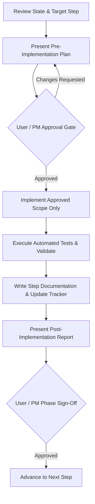

# AGENTS.md — Operational Rules & Agent Guidelines
# MARKET SENTINEL AI
## AI-Powered Stock Market Surveillance and Risk Intelligence Platform

---

> **CRITICAL DIRECTIVE**: The single source of truth for the entire project is [`docs/MASTER_IMPLEMENTATION_PROMPT.md`](file:///e:/Praxis/TERM%203/MARKET%20SENTINEL%20AI/docs/MASTER_IMPLEMENTATION_PROMPT.md). All AI agents, contributors, and automation processes MUST strictly adhere to its directives, phases, and quality standards.

---

## 1. Core Operating Principles

1. **Mandatory Baby-Step Implementation & Batch Execution Mode**:
   - DO NOT attempt to build the entire project in one unverified execution or write uncontrolled blocks of code across components.
   - Work strictly through the **12 defined phases** in sequential order.
   - Every phase must be subdivided into small, manageable, verified steps.
   - For every step or step sequence, present the plan before coding.
   - **Batch Execution Authorization**: When the user/PM explicitly authorizes a defined sequence of steps to be completed "in one go", the agent MUST execute all authorized steps sequentially in that run (implementing, testing, and documenting each step) without stopping for intermediate prompts, presenting the comprehensive verification report upon completion. Otherwise, halt for individual step review.

2. **Source of Truth & Session Continuity**:
   - At the beginning of every turn/session:
     1. Inspect repository state (`git status`, directory tree).
     2. Review [`docs/PROJECT_TRACKER.md`](file:///e:/Praxis/TERM%203/MARKET%20SENTINEL%20AI/docs/PROJECT_TRACKER.md) and [`docs/DECISION_LOG.md`](file:///e:/Praxis/TERM%203/MARKET%20SENTINEL%20AI/docs/DECISION_LOG.md).
     3. Identify the last completed and approved step.
     4. Resume only from that step or propose the next uncompleted step. Never regenerate or re-implement working code without explicit instruction.

3. **Product Boundary & Ethical Integrity**:
   - Market Sentinel AI is an **investigative decision-support system**, NOT an automated trading bot, trade execution engine, or automated accusation system.
   - Unusual market movement is a signal requiring investigation, never definitive proof of market manipulation or illicit activity.
   - All risk alerts must communicate confidence intervals, limitations, and empirical evidence.
   - **Zero Synthetic / Fake Financial Data**: Never generate fake stock prices or invent market history for model training or evaluation. If synthetic fixtures are required for unit tests, keep them isolated in `/tests/fixtures/` and clearly labelled.
   - **Zero Hallucination / Zero Fabrication**: The LLM must never invent market explanations. If supporting news or disclosures do not exist in the database, the agent/RAG system must explicitly state: *"Insufficient evidence found."*

---

## 2. Hardware Limitations & Resource Management

The project runs on a resource-constrained development environment:
- **OS**: Windows 11
- **RAM**: 16 GB (Shared system memory)
- **CPU**: Intel (x86_64)
- **GPU**: **No dedicated GPU** (CPU-only execution)
- **Container Runtime**: Docker Desktop

### Mandatory Hardware Rules:
- **CPU-Friendly ML & NLP**: Select lightweight models (e.g., standard statistical methods, Scikit-learn, small SentenceTransformers/HuggingFace embeddings optimized for CPU).
- **No Local Heavy LLMs**: Do not run local 7B+ LLMs (Ollama, vLLM) on this machine. LLM inference is handled via remote API abstractions (Groq API baseline).
- **Service Profiles via Docker Compose**:
  - Never run all services (PostgreSQL, Redis, Airflow, Redpanda, Spark, Prometheus, Grafana, Minikube) simultaneously.
  - Structure `docker-compose.yml` into distinct profiles:
    - `core`: PostgreSQL (with `pgvector`), FastAPI backend, React frontend.
    - `data`: Airflow scheduler and webserver (activated only during batch workflow runs).
    - `streaming`: Redpanda (single-broker, memory-capped) + consumers.
    - `monitoring`: Prometheus, Grafana, Alertmanager.
- **Resource Limits in Compose**: Every Docker container definition MUST specify memory and CPU limits (e.g., `mem_limit: 1g`).
- **Distributed Computing Constraints**: Apache Spark and Redpanda must only be booted for dedicated pipeline phases with small worker footprints.

---

## 3. Architecture Principles & Approved Stack Baseline

Every technology in the architecture must solve a concrete, justified requirement. No "resume-driven" or redundant additions.

| Layer | Approved Technology | Governance Rule |
|---|---|---|
| **Frontend** | React + TypeScript + Tailwind CSS | Type-safe, modular dashboard; no untyped `any` sprawl. |
| **Backend API** | FastAPI (Python 3.10+) | Clean layered architecture (routers, services, repositories). |
| **Primary Database** | PostgreSQL 16+ | Single source of truth for relational entities, transactions, and state. |
| **Vector Search** | `pgvector` extension in PostgreSQL | **Do NOT introduce separate vector databases** (e.g., Pinecone, Chroma, Milvus) unless PostgreSQL storage limits are exceeded and approved. |
| **Caching & Transient State** | Redis | Temporary state, rate-limiting, and caching only. Redis is NOT a system of record. |
| **Batch Orchestration** | Apache Airflow | Scheduled batch pipelines and data maintenance. Idempotent DAGs. |
| **Event Streaming** | Redpanda (Kafka-compatible) | Real-time event streaming where authorized feeds/webhooks exist. Do NOT move static CSVs over streaming brokers. |
| **Data Processing** | Pandas / Polars | Primary analytical transformations. Spark reserved only for distributed workloads that measurably exceed Pandas capacity. |
| **Analytical Storage** | Columnar Parquet / S3-compatible | Analytical snapshots, feature stores, historical archives. |
| **ML & Statistics** | Scikit-learn, Statsmodels, Arch | Statistical baselines first (z-score, rolling percentiles), then ML (Isolation Forest, GARCH). |
| **Experiment Tracking** | MLflow | Track parameters, metrics, model artifacts, and feature versions. |
| **Observability** | Prometheus + Grafana + Sentry + Evidently | Prometheus (metrics), Grafana (dashboards), Sentry (errors), Evidently (data & prediction drift). |
| **LLM Provider Layer** | Provider-independent abstraction (Groq baseline) | Decoupled interface (`generate`, `generate_structured`, `health_check`). API keys via `.env` only. |

---

## 4. Coding Conventions & Code Quality Standards

1. **Language & Environment**:
   - Python: Version >= 3.10, strict type hints (`typing`, `pydantic`), formatted via standard tools (`ruff` / `black`), docstrings for all modules, public functions, and classes.
   - TypeScript/React: Strict TypeScript, functional components, hooks, clean modular component hierarchy, no inline styling hacks.
2. **Architecture Separation of Concerns**:
   ```
   backend/
     api/           # HTTP endpoints / routers (FastAPI)
     core/          # Global config, security, logging, exceptions
     models/        # Pydantic schemas and SQLAlchemy / SQLModel ORM models
     repositories/  # Database access and query operations
     services/      # Business logic (alert computation, correlation, scoring)
     providers/     # External integrations (LLM abstraction, market data clients)
   ```
3. **Financial Modeling Standards**:
   - **No Look-Ahead Bias**: Features and anomaly scores must strictly use data available prior to the prediction timestamp.
   - **Chronological Validation**: Walk-forward or time-series split validation only. Random splits for time-series evaluation are strictly forbidden.
   - **Traceable Lineage**: Every alert and forecast must record model version, input feature snapshot, and execution timestamp.
4. **Error Handling & Resilience**:
   - Catch specific exceptions; never use bare `except: pass`.
   - Implement explicit retry logic with exponential backoff for external APIs (Groq, NSE, Alpha Vantage).
   - Core application must remain functional and graceful even when external LLM or news APIs are offline.

---

## 5. Security & Secret Governance

1. **No Hardcoded Secrets**:
   - API keys, database passwords, JWT secrets, and tokens MUST NEVER be committed to Git.
   - Store all credentials in `.env` (ignored by `.gitignore`).
   - Maintain an up-to-date [`.env.example`](file:///e:/Praxis/TERM%203/MARKET%20SENTINEL%20AI/.env.example) with sanitized placeholder values.
2. **Audit & Incident Protocol**:
   - If a secret or sensitive credential is accidentally committed or displayed, immediately stop, notify the user, invalidate the credential, and remove it from Git history.
3. **Data Governance & API Compliance**:
   - Comply with all data provider terms of service, robots.txt, rate limits, and licensing agreements.
   - Never bypass paywalls, scrape unauthorized login-gated services, or spoof scraping identities.

---

## 6. Documentation is a First-Class Deliverable

Documentation must be written concurrently with implementation, not deferred to the end of the project.

### Required Documentation Hierarchy:
```
docs/
  MASTER_IMPLEMENTATION_PROMPT.md  # Single Source of Truth
  PROJECT_TRACKER.md               # Master phase and step status tracker
  DECISION_LOG.md                  # Architectural & technology trade-off records
  KNOWN_ISSUES.md                  # Active bugs, constraints, and workarounds
  CHANGELOG.md                     # High-level chronological milestone changes
  business/                        # Problem statement, BRD, scope, success metrics
  architecture/                    # System diagrams, component architecture, data flow
  data/                            # Source registers, schemas, dictionaries, quality
  models/                          # Validation reports, drift audit, model registry
  genai/                           # RAG architecture, prompt templates, evals
  backend/                         # API documentation, database schemas
  frontend/                        # UI/UX wireframes, route specifications
  deployment/                      # Docker, Minikube, runbooks, resource profiles
  step_reports/                    # Granular per-step implementation reports
  phase_reports/                   # End-of-phase milestone completion reports
```

### Mandatory Step Report Structure (`docs/step_reports/phase_XX_step_YY_name.md`):
1. Objective & Business Relevance
2. Technical Explanation & Architectural Fit
3. Technology Decisions & Alternatives Considered
4. Files Created / Modified
5. Commands Executed & Testing Report (with actual terminal outputs)
6. Known Limitations, Risks & Edge Cases
7. Reproduction Instructions & Status

---

## 7. Approval Gates & Agent Protocol

Every agent operating in this repository MUST follow this protocol:



### Pre-Implementation Requirements (Before touching code):
Present to the user:
- **Phase & Step ID**
- **Objective & Business Relevance**
- **Technical Implementation Details**
- **Technology Choice & Rationale**
- **Expected Deliverables (exact file list)**
- **Acceptance Criteria & Test Plan**

### Post-Implementation Requirements (After execution):
Present to the user:
- **Implementation Summary**
- **Files Changed / Created**
- **Testing Results (commands and real outputs)**
- **Limitations & Discovered Blockers**
- **Updated Documentation & Project Tracker links**
- **Proposed Next Step**
- **WAIT FOR APPROVAL**: Do not advance to subsequent steps without explicit user confirmation, unless the user has authorized batch execution of a defined multi-step sequence "in one go". When authorized in batch mode, complete all planned steps in the sequence with their respective tests and documentation, then present the complete report.

---
*Follow these instructions with zero deviation. When in doubt, defer to [`docs/MASTER_IMPLEMENTATION_PROMPT.md`](file:///e:/Praxis/TERM%203/MARKET%20SENTINEL%20AI/docs/MASTER_IMPLEMENTATION_PROMPT.md) or ask the human project owner for clarification.*
