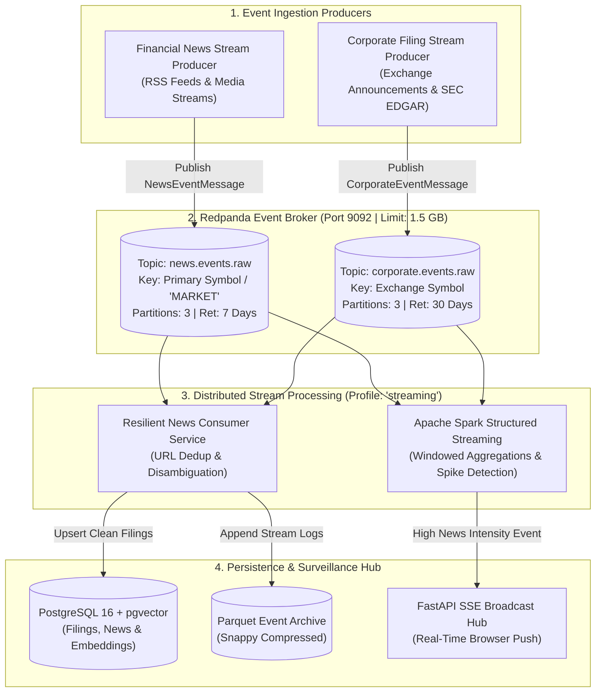

# EVENT STREAMING ARCHITECTURE & TOPOLOGY SPECIFICATION
# MARKET SENTINEL AI
## AI-Powered Stock Market Surveillance and Risk Intelligence Platform

---

## Document Control
- **Document Version**: 1.0.0
- **Status**: APPROVED / BASELINE
- **Author**: Principal System Architect & Lead Product Owner
- **Single Source of Truth**: [`docs/MASTER_IMPLEMENTATION_PROMPT.md`](file:///e:/Praxis/TERM%203/MARKET%20SENTINEL%20AI/docs/MASTER_IMPLEMENTATION_PROMPT.md)
- **Operational Guidelines**: [`AGENTS.md`](file:///e:/Praxis/TERM%203/MARKET%20SENTINEL%20AI/AGENTS.md)

---

## 1. Architectural Principles & Operational Boundaries

In strict compliance with Section 4 of [`docs/MASTER_IMPLEMENTATION_PROMPT.md`](file:///e:/Praxis/TERM%203/MARKET%20SENTINEL%20AI/docs/MASTER_IMPLEMENTATION_PROMPT.md) and Section 2 of [`AGENTS.md`](file:///e:/Praxis/TERM%203/MARKET%20SENTINEL%20AI/AGENTS.md), the event streaming subsystem is governed by four foundational rules:

1. **Genuine Event Stream Scope**:
   - Streaming brokers and consumers are dedicated exclusively to **genuine incoming financial news events and official corporate announcements** (`news.events.raw` and `corporate.events.raw`).
   - Static historical CSV files will **never** be pumped over Kafka topics to manufacture synthetic streaming activity.
2. **Zero Fake Real-Time Ticker Claims**:
   - Authorized real-time equity tick feeds (e.g. NSE Level 2/3) require expensive institutional co-location and commercial licensing. The platform explicitly maintains a **batch-first** market data model. Real-time streaming is presented truthfully as *news and corporate disclosure event streaming*.
3. **Hardware Containment (16 GB Development Limit)**:
   - All streaming services (Redpanda broker, Kafka consumers, and Apache Spark Structured Streaming) are encapsulated strictly inside the Docker Compose **`streaming`** profile.
   - Resource Quotas:
     - Redpanda Single-Broker: Capped at **$1.5\text{ GB}$ RAM**.
     - Apache Spark Single-Node: Capped at **$2.0\text{ GB}$ RAM**.
     - Active profile memory ceiling: $\le 3.5\text{ GB}$ RAM total, leaving ample headroom for host execution.
4. **Idempotency & Partitioning by Symbol**:
   - Message keys for corporate disclosures are strictly mapped to the primary exchange equity symbol (e.g. `key = 'RELIANCE'`). This guarantees per-stock strict chronological ordering within individual topic partitions.
   - Consumers enforce idempotent database upserts using event UUIDs and unique constraints.

---

## 2. Event Streaming Topology Diagram



---

## 3. Topic Definitions & Partitioning Strategy

| Topic Identifier | Partition Count | Message Key Strategy | Retention Period | Schema Standard | Description |
|---|---|---|---|---|---|
| **`news.events.raw`** | 3 | Primary detected `symbol` (or `'MARKET'` for macroeconomic news) | 7 Days ($168\text{ hours}$) | `news_event_schema.json` | Real-time financial media articles and RSS feed events. |
| **`corporate.events.raw`** | 3 | Exchange equity `symbol` (e.g. `'TATAMOTORS'`) | 30 Days ($720\text{ hours}$) | `corporate_event_schema.json` | Official exchange filings, board outcomes, and earnings releases. |
| **`news.intensity.spikes`** | 1 | Exchange equity `symbol` | 3 Days ($72\text{ hours}$) | Custom Alert JSON | Spark-derived events flagged when rolling article volume spikes $> 3\sigma$. |

### Message Ordering & Partitioning Rationale
- Partitioning by exchange `symbol` ensures that all events concerning a specific company land on the **same partition**.
- This guarantees strict monotonic ordering of corporate disclosures and news alerts for that entity, preventing race conditions where an analyst dossier processes an event out of chronological order.

---

## 4. Standardized Event Message Schemas

Both event message formats are formally validated against Draft-07 JSON Schema:

### 4.1 `NewsEventMessage` (`streaming/schemas/news_event_schema.json`)
```json
{
  "event_id": "8f3b2e1a-5c9d-4e2b-a123-9f8e7d6c5b4a",
  "canonical_url": "https://economictimes.indiatimes.com/stocks/tatamotors-jlr-surge",
  "title": "Tata Motors shares surge 6% on strong JLR global deliveries",
  "summary": "Tata Motors rallied following robust wholesale deliveries reported across Europe.",
  "body_text": null,
  "source_outlet": "Economic Times",
  "detected_symbols": ["TATAMOTORS"],
  "published_at_utc": "2026-11-17T04:45:30Z",
  "ingested_at_utc": "2026-11-17T04:46:10Z",
  "headline_hash": "a1b2c3d4e5f6789012345678abcdef01"
}
```

### 4.2 `CorporateEventMessage` (`streaming/schemas/corporate_event_schema.json`)
```json
{
  "event_id": "4a7b9c2d-1e3f-4a5b-9c8d-7e6f5a4b3c2d",
  "symbol": "TATAMOTORS",
  "category": "FINANCIAL_RESULTS",
  "subject": "Outcome of Board Meeting for Q2 Financial Results",
  "body_text": "The Board of Directors approved unaudited quarterly results with revenue up 18%.",
  "attachment_url": "https://nsearchives.nseindia.com/corporate/TATAMOTORS_17112026.pdf",
  "published_at_utc": "2026-11-17T14:45:00Z",
  "ingested_at_utc": "2026-11-17T14:45:15Z",
  "source_provider": "SRC-NSE-CORP-ANNOUNCEMENTS"
}
```

---

## 5. Consumer Offset & Error Handling Protocols

1. **Consumer Group Semantics**:
   - Consumers operate under designated consumer groups: `group.id = "sentinel-news-consumers"`.
   - Consumer offsets are managed automatically with manual offset commit (`enable.auto.commit = false`) executed only **after** successful database transaction commit.
2. **At-Least-Once Delivery & Idempotent Upserts**:
   - In distributed systems, broker rebalances or network timeouts can cause message redelivery.
   - The persistence layer executes idempotent upserts (`INSERT ... ON CONFLICT (id) DO NOTHING` or `DO UPDATE`), ensuring that duplicated delivery causes zero duplicate records or state corruption.
3. **Dead-Letter Queue (DLQ)**:
   - Malformed messages or payloads failing JSON Schema validation are committed and routed to `streaming.dead_letter.events` with diagnostic failure tags, preventing poison-pill messages from blocking consumer partition progression.
