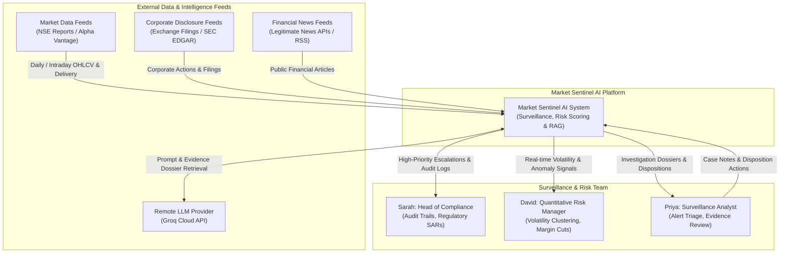
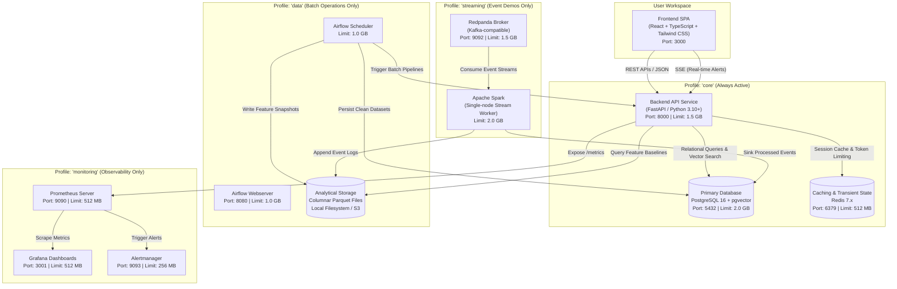
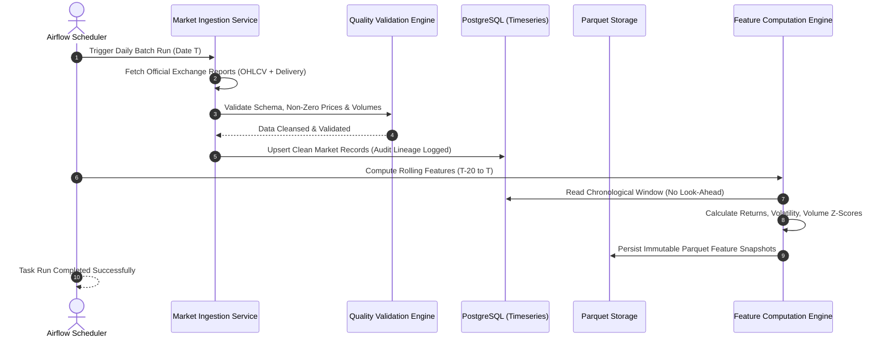
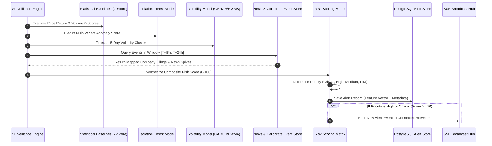
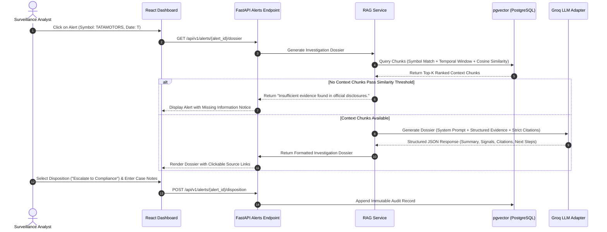

# SYSTEM ARCHITECTURE & DESIGN SPECIFICATION
# MARKET SENTINEL AI
## AI-Powered Stock Market Surveillance and Risk Intelligence Platform

---

## Document Control
- **Document Version**: 1.0.0
- **Status**: APPROVED / BASELINE
- **Author**: Principal System Architect & Lead Product Owner
- **Single Source of Truth**: [`docs/MASTER_IMPLEMENTATION_PROMPT.md`](file:///e:/Praxis/TERM%203/MARKET%20SENTINEL%20AI/docs/MASTER_IMPLEMENTATION_PROMPT.md)
- **Operational Guidelines**: [`AGENTS.md`](file:///e:/Praxis/TERM%203/MARKET%20SENTINEL%20AI/AGENTS.md)

---

## 1. Architectural Philosophy & Design Principles

Market Sentinel AI is engineered around five fundamental architectural tenets:

1. **Layered Separation of Concerns (SoC)**:
   - Presentation, application services, domain business logic, data access repositories, and external provider adapters are strictly decoupled.
2. **Hardware-Aware Containment**:
   - Designed to run within a **16 GB RAM, CPU-only** development footprint on Windows 11. Multi-service dependencies are organized into isolated Docker Compose profiles (`core`, `data`, `streaming`, `monitoring`) with hard memory quotas (`mem_limit`).
3. **Single System of Record with Vector Co-location**:
   - PostgreSQL 16+ is the single transactional source of truth. Vector embeddings for corporate filings and news disclosures reside directly in PostgreSQL via `pgvector`, eliminating the operational overhead and dual-write inconsistencies of a separate vector database.
4. **Provider-Decoupled Generative AI**:
   - LLM interactions route through an abstract provider interface (`LLMProviderInterface`). Groq API is the baseline implementation; future migrations to OpenAI, Gemini, or local models require zero changes to business logic.
5. **Zero Look-Ahead Bias & Auditability**:
   - Data storage, feature computation, and model inference pipelines maintain strict chronological lineage. Every generated risk alert stores an immutable snapshot of triggering feature values, model versions, and source timestamps.

---

## 2. C4 Architecture Level 1: System Context Diagram

The System Context diagram illustrates how Market Sentinel AI integrates into the broader financial market ecosystem, interacts with external data sources, and serves distinct user roles.

---

## 3. C4 Architecture Level 2: Container Architecture & Service Profiles

To respect the **16 GB RAM limit**, containers are partitioned into four modular Docker Compose profiles. Users only boot the profiles required for the active operational workload.

---

## 4. C4 Architecture Level 3: Backend Component Architecture

The backend adheres to a clean layered architecture within FastAPI:

```mermaid
flowchart TD
    subgraph Presentation["Presentation & Routing Layer (FastAPI Routers)"]
        R_AUTH["Auth Router<br/>(/api/v1/auth)"]
        R_MARKET["Market Data Router<br/>(/api/v1/market)"]
        R_ANOMALY["Anomaly & Vol Router<br/>(/api/v1/analytics)"]
        R_NEWS["News & Events Router<br/>(/api/v1/news)"]
        R_ALERT["Alerts & Dossier Router<br/>(/api/v1/alerts)"]
        R_SSE["SSE Notification Router<br/>(/api/v1/events)"]
    end

    subgraph Application["Application Business Logic Layer (Services)"]
        S_INGEST["Ingestion Service<br/>(Validation & Normalization)"]
        S_ANOMALY["Anomaly Detection Service<br/>(Z-Score + Isolation Forest)"]
        S_VOL["Volatility Service<br/>(EWMA + GARCH Forecast)"]
        S_NLP["NLP Intelligence Service<br/>(NER + Event Classifier)"]
        S_CORR["Risk Scoring Engine<br/>(Multi-Factor Correlation)"]
        S_RAG["RAG Orchestrator<br/>(pgvector + Prompt Synthesis)"]
    end

    subgraph Abstraction["Provider & Integration Layer"]
        P_LLM["LLM Provider Interface<br/>(Groq Adapter / Fallbacks)"]
        P_DATA["Market Data Client<br/>(NSE / Alpha Vantage)"]
        P_EMBED["Embedding Client<br/>(CPU-Optimized SentenceTransformer)"]
    end

    subgraph DataAccess["Persistence & Repository Layer"]
        REPO_MKT["Market Repository"]
        REPO_ALERT["Alert Repository"]
        REPO_DOC["Document & Vector Repository"]
        REPO_AUDIT["Audit & Disposition Repository"]
    end

    R_MARKET --> S_INGEST
    R_ANOMALY --> S_ANOMALY
    R_ANOMALY --> S_VOL
    R_NEWS --> S_NLP
    R_ALERT --> S_CORR
    R_ALERT --> S_RAG

    S_INGEST --> P_DATA
    S_INGEST --> REPO_MKT
    S_ANOMALY --> REPO_MKT
    S_VOL --> REPO_MKT
    S_NLP --> REPO_DOC
    S_CORR --> REPO_MKT
    S_CORR --> REPO_DOC
    S_CORR --> REPO_ALERT
    S_RAG --> P_EMBED
    S_RAG --> REPO_DOC
    S_RAG --> P_LLM
    S_RAG --> REPO_ALERT
```

---

## 5. End-to-End Data Flow Diagrams

### 5.1 Batch Data Ingestion & Feature Engineering Flow
Orchestrated via Apache Airflow on daily/scheduled triggers:

### 5.2 Anomaly Detection, Volatility Modeling & Risk Scoring Flow
Transforms raw market features into prioritized investigation alerts:

### 5.3 Evidence-Grounded RAG Investigation Dossier Flow
Enforces zero hallucination and evidence citations:

---

## 6. Security, Authentication & Session Architecture

- **Stateless Authentication**: JSON Web Tokens (JWT) using HMAC-SHA256 (`HS256`).
- **Role-Based Access Control (RBAC)**:
  - `Analyst`: View monitors, inspect alerts, review RAG dossiers, add investigation notes, dismiss low/medium alerts.
  - `Senior Compliance Officer`: All Analyst permissions + escalate alerts, export official SAR packages, configure scoring weights.
  - `System Admin`: Manage user accounts, trigger pipeline re-runs, inspect system metrics.
- **Credential Storage**: Passwords hashed using `bcrypt` with salt rounds $\ge 12$. Secrets loaded via environment variables; never committed to Git.
