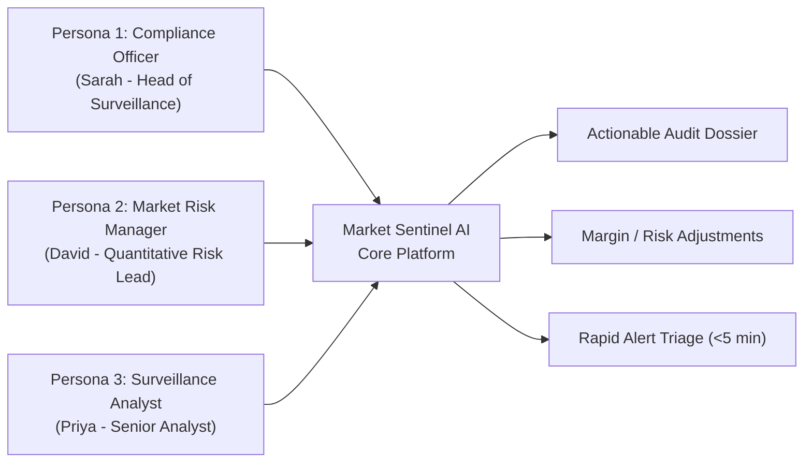

# BUSINESS REQUIREMENTS DOCUMENT (BRD)
# MARKET SENTINEL AI
## AI-Powered Stock Market Surveillance and Risk Intelligence Platform

---

## Document Control
- **Document Version**: 1.0.0
- **Status**: APPROVED / BASELINE
- **Author**: Principal System Architect & Lead Product Owner
- **Single Source of Truth**: [`docs/MASTER_IMPLEMENTATION_PROMPT.md`](file:///e:/Praxis/TERM%203/MARKET%20SENTINEL%20AI/docs/MASTER_IMPLEMENTATION_PROMPT.md)
- **Operational Guidelines**: [`AGENTS.md`](file:///e:/Praxis/TERM%203/MARKET%20SENTINEL%20AI/AGENTS.md)

---

## 1. Project Background & Business Context

Financial markets represent complex, adaptive systems where informational asymmetries, extreme volatility, and market abuse (such as front-running, pump-and-dump schemes, and insider trading) threaten market integrity and investor confidence. 

Institutional brokerages, proprietary trading desks, clearing corporations, and regulatory compliance teams face a dual crisis:
1. **Alert Fatigue**: Static, rule-based surveillance systems trigger thousands of alerts daily with false positive rates exceeding 90%.
2. **Context Fragmentation**: Analysts must manually cross-reference market anomalies with exchange filings, press releases, earnings reports, and news wires across disparate, disconnected tools.

**Market Sentinel AI** bridges this gap by unifying statistical anomaly detection, volatility forecasting, NLP news intelligence, and hallucination-free Retrieval-Augmented Generation (RAG) into a single, cohesive surveillance and decision-support cockpit.

---

## 2. User Personas & Detailed User Stories

### 2.1 Persona 1: Sarah — Head of Surveillance & Compliance
- **Profile**: 15+ years in regulatory compliance at a Tier-1 institutional broker.
- **Pain Point**: Spends excessive executive time reviewing false alarms and defending surveillance methodology during SEBI/SEC audits.
- **User Stories**:
  - *US-1.1*: As a Compliance Officer, I want every generated alert to have an immutable audit trail (including triggering feature snapshots, model versions, and raw data timestamps) so that our desk can defend our surveillance procedures during regulatory examinations.
  - *US-1.2*: As a Compliance Officer, I want to review an escalation queue sorted by calibrated risk priority (Critical, High, Medium, Low) so that urgent investigations are addressed within strict statutory timeframes.
  - *US-1.3*: As a Compliance Officer, I want one-click export of an investigation case file (including market charts, relevant filings, and analyst notes) to attach to formal Suspicious Activity Reports (SAR).

### 2.2 Persona 2: David — Quantitative Risk Manager
- **Profile**: Lead Risk Manager for equity derivatives and proprietary trading books.
- **Pain Point**: Sudden, unhedged volatility expansions and liquidity gaps that trigger margin breaches before historical VaR models react.
- **User Stories**:
  - *US-2.1*: As a Risk Manager, I want short-term volatility forecasts (via EWMA and GARCH models) alongside rolling historical volatility so that I can anticipate volatility clustering before extreme drawdowns occur.
  - *US-2.2*: As a Risk Manager, I want to filter anomalous stocks by liquidity bands and delivery volume percentage to detect illiquid cornering or artificial volume inflation.
  - *US-2.3*: As a Risk Manager, I want real-time notification via Server-Sent Events (SSE) when a monitored constituent breaches a $3\sigma$ price or volatility threshold so that I can adjust margin haircuts immediately.

### 2.3 Persona 3: Priya — Senior Surveillance & Research Analyst
- **Profile**: Operational analyst responsible for triaging 50–100 flagged market movements daily.
- **Pain Point**: Spends 45 minutes per alert manually querying exchange filing portals, financial news websites, and historical charts to identify why a stock spiked.
- **User Stories**:
  - *US-3.1*: As a Surveillance Analyst, I want an AI-synthesized investigation briefing that summarizes observed anomalies and correlates them with retrieved corporate disclosures so that I can triage an alert in under 5 minutes.
  - *US-3.2*: As a Surveillance Analyst, I want all claims made in the AI briefing to carry clickable citations linking directly to verified source articles and filings so that I never act on an unverified narrative.
  - *US-3.3*: As a Surveillance Analyst, I want the system to explicitly declare *"Insufficient evidence found"* when an anomaly has no matching corporate news, rather than guessing or hallucinating an explanation.
  - *US-3.4*: As a Surveillance Analyst, I want to dismiss or escalate alerts with standardized disposition tags (e.g., "Earnings Reaction - Legitimate", "Unexplained Price/Volume Surge - Escalate") and record custom notes for desk audit logs.

---

## 3. Functional Requirements (FR)

The system is organized into eight core functional modules:

### Module 1: Market Data Intelligence
- **FR-1.1**: The system MUST ingest daily and intraday OHLCV (Open, High, Low, Close, Volume) data from authentic sources (e.g., NSE official historical reports, Alpha Vantage).
- **FR-1.2**: The system MUST maintain a standardized Company & Symbol Master mapping exchange tickers, company legal names, and exchange codes.
- **FR-1.3**: The system MUST store and process delivery quantity and delivery percentage where official reports provide such data.
- **FR-1.4**: The system MUST perform automated data quality checks on ingestion: rejecting negative prices, zero volumes on active trading days, and duplicate timestamps.
- **FR-1.5**: The system MUST preserve full data lineage: recording source provider, ingestion timestamp, and original file hash for every market record.

### Module 2: Abnormal Trading Activity Detection
- **FR-2.1**: The system MUST calculate statistical baselines for returns, price gaps, and volumes using rolling windows (e.g., 20-day, 50-day rolling Z-scores and IQR percentiles).
- **FR-2.2**: The system MUST execute unsupervised ML anomaly detection using Isolation Forest trained strictly on chronological historical features without look-ahead bias.
- **FR-2.3**: The system MUST compute volume anomalies comparing current volume against time-matched historical distributions.
- **FR-2.4**: The system MUST output an anomaly score normalized between $0.0$ and $1.0$ alongside the contributing feature vector.

### Module 3: Volatility Intelligence
- **FR-3.1**: The system MUST calculate historical rolling volatility (standard deviation of log returns across 10, 20, and 30-day windows).
- **FR-3.2**: The system MUST implement Exponentially Weighted Moving Average (EWMA) volatility to capture volatility clustering.
- **FR-3.3**: The system MUST provide GARCH(1,1) volatility modeling and short-term volatility forecasting where statistical convergence criteria are met.
- **FR-3.4**: The system MUST track and compare volatility forecast errors (RMSE, MAE) over walk-forward test periods.

### Module 4: News & Corporate Disclosure Intelligence
- **FR-4.1**: The system MUST ingest unstructured news articles, press releases, and exchange corporate disclosures from legitimate public feeds.
- **FR-4.2**: The system MUST perform text cleaning, boilerplate removal, and deduplication of syndicate/repeated news stories.
- **FR-4.3**: The system MUST execute Named Entity Recognition (NER) to extract company names and map them to standardized stock symbols with confidence scores.
- **FR-4.4**: The system MUST classify corporate events into standardized categories (e.g., Earnings, M&A, Regulatory Action, Management Change, Legal Dispute, Operational Update).
- **FR-4.5**: The system MUST compute financial sentiment polarity and news intensity metrics (article volume spikes relative to baseline coverage).

### Module 5: Temporal Correlation & Risk Alert Engine
- **FR-5.1**: The system MUST correlate market anomaly timestamps with news/disclosure publication timestamps across configurable lead/lag windows (e.g., $t-48\text{h}$ to $t+24\text{h}$).
- **FR-5.2**: The system MUST compute a composite Risk Score ($0-100$) integrating:
  $$\text{Risk Score} = w_1 \cdot \text{AnomalyScore} + w_2 \cdot \text{VolSurge} + w_3 \cdot \text{NewsIntensity} + w_4 \cdot \text{EventSeverity} + w_5 \cdot \text{InformationGap}$$
- **FR-5.3**: The system MUST assign an investigation priority: Critical ($\ge 85$), High ($70-84$), Medium ($50-69$), Low ($<50$).
- **FR-5.4**: The system MUST create an immutable Alert Record storing: Alert ID, Symbol, Timestamp, Anomaly Vector, Triggering News IDs, Composite Risk Score, and Model Metadata.

### Module 6: Generative AI & Evidence-Grounded RAG Assistant
- **FR-6.1**: The system MUST chunk and embed ingested news and corporate disclosures into vector representations stored in PostgreSQL using `pgvector`.
- **FR-6.2**: The system MUST implement hybrid retrieval: filtering candidate documents by stock symbol, date window, and vector cosine similarity.
- **FR-6.3**: The system MUST provide a decoupled LLM provider abstraction supporting remote inference (Groq baseline) via a unified interface (`generate`, `generate_structured`, `health_check`).
- **FR-6.4**: The system MUST generate a structured Investigation Dossier containing: Executive Summary, Observed Anomaly Metrics, Retrieved Evidence, Cross-Modal Synthesis, Grounded Citations, and Recommended Next Steps.
- **FR-6.5**: The system MUST enforce a zero-hallucination guardrail: if no relevant documents match the retrieval threshold, the LLM must output: *"Insufficient evidence found in official disclosures."*
- **FR-6.6**: The system MUST implement token usage tracking and caching in Redis to prevent redundant LLM invocations.

### Module 7: Analyst Investigation Dashboard
- **FR-7.1**: The system MUST deliver an interactive web interface (React, TypeScript, Tailwind CSS) displaying:
  1. Executive Surveillance Overview (market-wide heatmaps, active alert counters).
  2. Alert Centre (filterable, sortable table of alerts by risk tier, date, symbol).
  3. Interactive Stock Deep-Dive (candlestick chart with overlaid anomaly markers, volume bars, and volatility bands).
  4. AI Investigation Dossier view with interactive citations linked to source text.
  5. Analyst Disposition workflow (Escalate, Dismiss, Inquire) with audit notes.
- **FR-7.2**: The system MUST push real-time alerts to the browser using Server-Sent Events (SSE).
- **FR-7.3**: The system MUST provide role-based access control (RBAC): separating Read-Only Analysts from Senior Compliance Officers with escalation authorization.

### Module 8: System Observability & Model Drift Monitoring
- **FR-8.1**: The system MUST expose Prometheus metrics for API latency, error rates, ingestion pipeline duration, and model inference duration.
- **FR-8.2**: The system MUST provide pre-configured Grafana dashboards for system infrastructure, pipeline throughput, and model health.
- **FR-8.3**: The system MUST generate scheduled data drift and prediction distribution drift reports using Evidently AI.
- **FR-8.4**: The system MUST track all model parameters, metrics, and serialized artifacts in MLflow.
- **FR-8.5**: The system MUST log application exceptions and performance bottlenecks to Sentry.

---

## 4. Non-Functional Requirements (NFR)

### NFR-1: Hardware & Resource Efficiency
- **NFR-1.1**: The entire platform MUST operate reliably on a single development machine with **16 GB RAM, x86_64 CPU, and no dedicated GPU**.
- **NFR-1.2**: All Docker containers MUST have strict CPU and memory limits defined in `docker-compose.yml` (e.g. `mem_limit: 1g`).
- **NFR-1.3**: The system MUST support isolated Docker Compose profiles (`core`, `data`, `streaming`, `monitoring`) so that heavy services (Airflow, Redpanda, Spark) are not run concurrently with the core web application.
- **NFR-1.4**: All local ML and embedding models MUST be CPU-optimized (e.g., `all-MiniLM-L6-v2` or Scikit-learn). No local 7B+ LLMs shall be run on the host.

### NFR-2: Performance & Response Latencies
- **NFR-2.1**: REST API endpoints for stock data and alert listings MUST respond in $< 200\text{ ms}$ for $95\%$ of requests.
- **NFR-2.2**: Vector similarity search in `pgvector` across 50,000 document chunks MUST complete in $< 100\text{ ms}$.
- **NFR-2.3**: End-to-end RAG dossier synthesis (including retrieval and Groq API generation) MUST complete in $< 5\text{ seconds}$.
- **NFR-2.4**: Real-time SSE alert notifications MUST reach connected browser clients within $< 1\text{ second}$ of alert generation.

### NFR-3: Data Integrity, Security & Regulatory Compliance
- **NFR-3.1**: **Zero Synthetic Financial Data**: All price, volume, and corporate action records evaluated in the platform MUST originate from authentic, traceable market feeds.
- **NFR-3.2**: **Zero Look-Ahead Bias**: Feature engineering and anomaly detection pipelines MUST use strictly point-in-time data available prior to the prediction timestamp.
- **NFR-3.3**: Secrets (API keys, DB passwords, JWT tokens) MUST NEVER be committed to Git. All configuration must be loaded from `.env` validated against [`.env.example`](file:///e:/Praxis/TERM%203/MARKET%20SENTINEL%20AI/.env.example).
- **NFR-3.4**: All user passwords MUST be hashed using bcrypt before database persistence. API routes MUST be protected via JWT Bearer tokens.

### NFR-4: Auditability & Lineage
- **NFR-4.1**: Every risk alert MUST store an immutable record of the input feature snapshot, model identifier, and timestamp.
- **NFR-4.2**: Analyst disposition actions (dismissal, escalation, notes) MUST be immutably recorded in a database audit log with user ID and timestamp.

### NFR-5: Maintainability & Code Quality
- **NFR-5.1**: Backend code MUST adhere to Python 3.10+, PEP 8, strict type hints (`typing`, Pydantic models), and pass Ruff linting.
- **NFR-5.2**: Frontend code MUST adhere to strict TypeScript (no untyped `any` sprawl) and clean modular component hierarchy.
- **NFR-5.3**: Unit and integration test coverage MUST exceed $80\%$ across core business logic, feature engineering, and alert generation.

---

## 5. Requirements Traceability Matrix

| Requirement ID | Module / Category | Phase Mapped | Verification Method |
|---|---|---|---|
| **FR-1.1 – FR-1.5** | Market Data Intelligence | Phase 2 & 3 | Automated data validation tests, schema checks |
| **FR-2.1 – FR-2.4** | Anomaly Detection | Phase 5 & 6 | Statistical unit tests, Isolation Forest benchmarks |
| **FR-3.1 – FR-3.4** | Volatility Intelligence | Phase 5 & 6 | RMSE/MAE validation, walk-forward time splits |
| **FR-4.1 – FR-4.5** | News & NLP Intelligence | Phase 7 | Entity extraction precision/recall, event F1 tests |
| **FR-5.1 – FR-5.4** | Risk Alert Engine | Phase 8 | Backtest replay tests, alert scoring calibration |
| **FR-6.1 – FR-6.6** | GenAI & Grounded RAG | Phase 9 | Grounding evaluation, mock LLM tests, citation audits |
| **FR-7.1 – FR-7.3** | Dashboard & UI | Phase 10 | Frontend component tests, E2E workflow tests |
| **FR-8.1 – FR-8.5** | Observability & Drift | Phase 11 | Prometheus metrics scrape, Evidently drift reports |
| **NFR-1.1 – NFR-1.4** | Resource Management | Phase 12 | Docker memory profiling, CPU benchmark |
| **NFR-3.1 – NFR-3.4** | Security & Integrity | Cross-Cutting | Git history secret scan, chronological leakage audit |
