# BUSINESS PROBLEM STATEMENT
# MARKET SENTINEL AI
## AI-Powered Stock Market Surveillance and Risk Intelligence Platform

---

## 1. Executive Summary

Modern equity markets operate at immense speed, generating millions of trade executions, quote updates, and corporate events every trading day. Regulators (such as SEBI in India and SEC in the US), institutional brokers, asset managers, and proprietary trading desks are mandated to surveil market activity to preserve market integrity, detect potential insider trading, identify front-running or circular trading patterns, and manage extreme market risk.

However, existing market surveillance infrastructure relies almost exclusively on static, threshold-based legacy rules (e.g., alert if volume exceeds 3x 20-day moving average or price moves $\pm 5\%$). These heuristic systems generate a crushing volume of false positives—frequently exceeding **90% of total alerts**. Compliance and risk analysts are overwhelmed by alert fatigue, forced to spend hours manually searching news feeds, regulatory disclosure portals, and historical order books to determine if an anomaly was driven by legitimate news or warrants escalation.

**Market Sentinel AI** solves this operational bottleneck. It is an end-to-end investigative decision-support platform that ingests real-world market data and company disclosures, detects statistical and machine learning anomalies, forecasts volatility, correlates anomalies with verified news disclosures, and synthesizes grounded, hallucination-free investigative intelligence using Retrieval-Augmented Generation (RAG).

---

## 2. Industry Context & Regulatory Landscape

### 2.1 The Surveillance Mandate
Broker-dealers, clearing corporations, asset management companies, and exchanges must comply with strict surveillance and anti-fraud regulations:
- **India (SEBI)**: Prevention of Insider Trading (PIT) Regulations, Prohibition of Fraudulent and Unfair Trade Practices (PFUTP) Regulations, and mandatory institutional broker surveillance systems for abnormal order-to-trade ratios and synchronized trades.
- **United States (SEC / FINRA)**: FINRA Rule 3110 (Supervision), Rule 5210 (Publication of Transactions and Quotations), and Market Access Rule 15c3-5 requiring real-time risk controls and post-trade surveillance for market manipulation (spoofing, layering, wash sales, insider trading).

### 2.2 The Anatomy of Modern Market Manipulation & Risks
1. **Unusual Volume Accumulation**: Abnormal accumulation or distribution prior to price-sensitive announcements (earnings, M&A, regulatory sanctions).
2. **Pump-and-Dump & Social Media Hype**: Coordinated price elevation followed by sharp liquidation, often targeting illiquid micro-caps.
3. **Volatility Spikes without Information Flow**: Drastic intraday price discovery in the complete absence of verified corporate announcements.
4. **Front-Running / Tail-Gating**: Accumulating positions ahead of large institutional block executions.

---

## 3. Current State vs. Market Sentinel AI Workflow

```mermaid
flowchart TD
    subgraph Legacy["Legacy Heuristic Surveillance"]
        L1["Static Threshold Trigger (e.g. Vol > 3x MA)"] --> L2["Massive Alert Influx (>90% False Positives)"]
        L2 --> L3["Manual News & Filing Lookup Across 5+ Tabs"]
        L3 --> L4["Analyst Alert Fatigue & Delayed Triage"]
        L4 --> L5["High Risk of Overlooked Illicit Trading"]
    end

    subgraph Sentinel["Market Sentinel AI Workflow"]
        S1["Clean Market Data Ingestion (OHLCV & Delivery)"] --> S2["Multi-Tier Anomaly Engine (Z-score + Isolation Forest + GARCH)"]
        S3["News & Disclosure NLP Ingestion"] --> S4["Temporal Correlation & Risk Scoring Engine"]
        S2 --> S4
        S4 --> S5["Prioritized Risk Alert (<20% False Positive Triage Load)"]
        S5 --> S6["Grounded RAG Investigation Dossier (pgvector + Citations)"]
        S6 --> S7["Single-Pane Analyst Dashboard: Escalate / Dismiss"]
    end
```

### 3.1 Pain Points of Current Surveillance Desks
| Dimension | Legacy Workflow | Market Sentinel AI Target |
|---|---|---|
| **Alert Quality** | Static rules trigger alerts on routine market-wide beta movement. | Unsupervised ML + multi-factor scoring isolates idiosyncratic behavior. |
| **Context Synthesis** | Zero context; analyst manually queries Google, Bloomberg, and exchange filings. | Real-time automated ingestion and entity-mapped corporate filing lookup. |
| **Investigation Time** | 45–90 minutes per escalated alert. | **Under 5 minutes** with pre-compiled evidence dossiers and citations. |
| **Explainability** | Black-box boolean triggers ("Threshold Exceeded"). | Feature importance, rolling percentile comparisons, and grounded summaries. |
| **Operational Scalability** | Linear analyst headcount required as stock coverage expands. | Sub-linear headcount scaling; risk prioritization filters non-material noise. |

---

## 4. Target User Personas & Use Cases

### Persona 1: Institutional Compliance Officer
- **Role**: Head of Surveillance at a Tier-1 Brokerage / Asset Manager.
- **Goal**: Maintain regulatory audit trails, detect insider trading or front-running prior to regulatory inquiry, and satisfy SEBI/SEC inspection mandates.
- **Workflow in Market Sentinel**: Inspects daily high-priority risk alerts, verifies automated corporate disclosure mapping, and signs off on regulatory SAR (Suspicious Activity Report) escalation packages.

### Persona 2: Risk Management Analyst
- **Role**: Middle-office market risk monitor at a proprietary trading desk or hedge fund.
- **Goal**: Identify unexpected volatility expansions, sudden liquidity evaporation, and collateral risk in client holdings.
- **Workflow in Market Sentinel**: Monitors intraday volatility forecasts (GARCH/EWMA), tracks liquidity gaps, and triggers collateral adjustments or margin calls.

### Persona 3: Equity Research & Surveillance Analyst
- **Role**: Junior analyst triaging flagged tickers.
- **Goal**: Quickly determine if an 8% price spike was an earnings beat, product approval, or completely unbacked movement.
- **Workflow in Market Sentinel**: Reviews the AI-generated dossier, reads cited news snippets, checks historical volume percentiles, adds case notes, and dismisses or escalates in 1 click.

---

## 5. Proposed Solution: Core Functional Modules

1. **Market Data Intelligence**: Ingests, cleans, and structures authentic daily and intraday OHLCV market records, volume distributions, and delivery metrics without synthetic fabrication.
2. **Abnormal Trading Activity Detection**: Combines rolling statistical baselines (Z-score, IQR) with unsupervised machine learning (Isolation Forest) to surface true statistical outliers.
3. **Volatility Intelligence**: Models historical, EWMA, and GARCH volatility dynamics to separate routine market dispersion from abnormal volatility clustering.
4. **News & Disclosure NLP Intelligence**: Ingests genuine regulatory filings and news feeds, performs named entity recognition (NER), maps entities to stock tickers, and extracts sentiment and event classes.
5. **Correlation & Risk Scoring Engine**: Calculates multi-dimensional risk scores combining market anomaly magnitude, volatility expansion, news timing (lead/lag relationships), and source credibility.
6. **Generative AI & Grounded RAG Assistant**: Employs vector semantic search (`pgvector`) and an LLM provider abstraction (Groq baseline) to synthesize human-readable investigation briefs strictly anchored in verified evidence.
7. **Analyst Investigation Console**: A React/TypeScript interactive dashboard providing unified charts, alert queues, filing inspection, and audit-logged escalation workflows.
8. **System Observability & Model Drift Monitoring**: Real-time metrics via Prometheus/Grafana and data/prediction drift audits via Evidently AI.

---

## 6. Business Impact & Measurable Success Targets

- **$\ge 75\%$ Reduction in Triage Time**: Cut average investigation time per alert from 45 minutes to under 10 minutes.
- **$\ge 50\%$ Reduction in False-Positive Escalations**: Prioritization scoring prevents routine high-beta market days from flooding compliance inboxes.
- **100% Traceability & Audit Readiness**: Every alert and AI explanation links directly to immutable feature snapshots, model versions, and source URLs.
- **Zero Hallucination Mandate**: When no supporting corporate disclosures or news articles exist for an abnormal move, the system guarantees an explicit report: *"Insufficient evidence found in registered disclosures."*

---

## 7. Product Boundary & Ethical Guardrails

To preserve academic integrity and financial regulatory compliance, Market Sentinel AI enforces strict non-negotiable boundaries:

1. **Decision Support, Not Automated Accusation**:
   - The platform flags **abnormal activity requiring human investigation**.
   - It **never** issues definitive legal accusations (e.g. "Stock X is engaged in illegal insider trading").
2. **No Trade Execution / No Investment Advice**:
   - The platform is **not a trading bot** and provides no buy/sell recommendations.
3. **No Synthetic Financial Market Data**:
   - Stock prices, volumes, and returns are strictly sourced from verified exchanges and official APIs. No synthetic prices will be passed as real evaluation data.
4. **Zero-Hallucination Integrity**:
   - The generative AI module is constrained strictly to retrieved context. It is strictly forbidden from extrapolating rumors or inventing speculative narratives.
