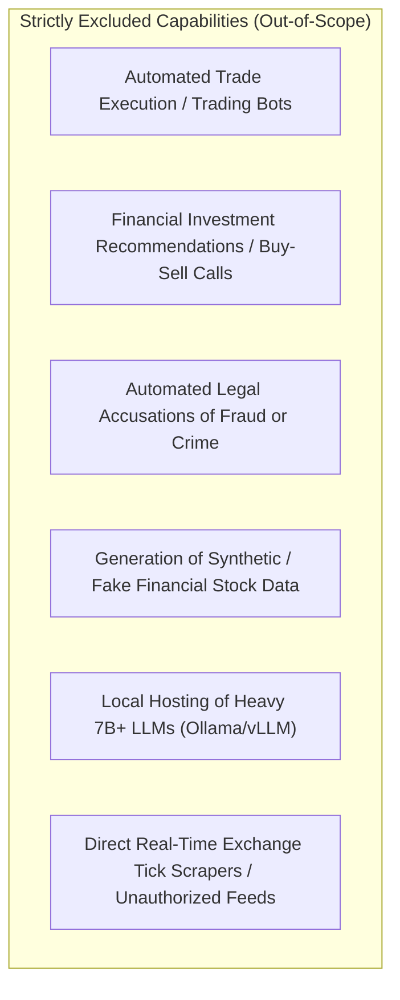

# PRODUCT SCOPE & BOUNDARY SPECIFICATION
# MARKET SENTINEL AI
## AI-Powered Stock Market Surveillance and Risk Intelligence Platform

---

## Document Control
- **Document Version**: 1.0.0
- **Status**: APPROVED / BASELINE
- **Author**: Principal System Architect & Lead Product Owner
- **Single Source of Truth**: [`docs/MASTER_IMPLEMENTATION_PROMPT.md`](file:///e:/Praxis/TERM%203/MARKET%20SENTINEL%20AI/docs/MASTER_IMPLEMENTATION_PROMPT.md)
- **Operational Guidelines**: [`AGENTS.md`](file:///e:/Praxis/TERM%203/MARKET%20SENTINEL%20AI/AGENTS.md)

---

## 1. Executive Product Vision

**Market Sentinel AI** is an AI-powered financial market surveillance and investigative decision-support platform. It ingests authentic market data and corporate disclosures, identifies statistical and machine learning anomalies, forecasts volatility, correlates market behavior with company announcements, and synthesizes evidence-grounded risk dossiers using Retrieval-Augmented Generation (RAG).

To ensure high engineering quality, academic rigor, and reliable execution on a resource-constrained development environment (16 GB RAM, CPU-only execution), this document establishes clear boundaries between:
1. **Core Minimum Viable Product (MVP)**
2. **Extended & Demonstrative Capabilities**
3. **Explicitly Excluded Capabilities (Out-of-Scope)**

---

## 2. In-Scope: Minimum Viable Product (MVP)

The MVP represents the foundational, fully functional system required to demonstrate the complete surveillance intelligence loop:

```mermaid
flowchart LR
    A["Authentic Market Data<br/>& Corporate Filings"] --> B["Data Pipelines<br/>(PostgreSQL + Parquet)"]
    B --> C["Feature Engineering<br/>(Returns, Vol, News Spikes)"]
    C --> D["Anomaly & Volatility<br/>(Z-Score, IsoForest, GARCH)"]
    D --> E["Risk Scoring Engine<br/>(Priority Matrix)"]
    E --> F["pgvector Semantic Retrieval<br/>& Groq LLM Dossier"]
    F --> G["React Surveillance Dashboard<br/>(Triage, Escalate, Dismiss)"]
    G --> H["Observability & Drift<br/>(Prometheus, Evidently)"]
```

| Domain | In-Scope MVP Features |
|---|---|
| **Market Data** | Batch ingestion of genuine historical daily/intraday OHLCV and delivery records (e.g. NSE official reports, Alpha Vantage); automated data quality validation; standardized Company & Symbol Master. |
| **Storage Architecture** | Relational data persistence in PostgreSQL 16+; analytical time-series feature snapshots in columnar Parquet format; vector embeddings in PostgreSQL using `pgvector`. |
| **Batch Orchestration** | Scheduled, idempotent data ingestion and feature calculation pipelines orchestrated via Apache Airflow. |
| **Statistical & ML Anomaly Detection** | Rolling statistical baselines (Z-scores, rolling percentiles); unsupervised machine learning (Isolation Forest) trained strictly on chronological time-series splits (zero look-ahead bias). |
| **Volatility Intelligence** | Rolling historical volatility; Exponentially Weighted Moving Average (EWMA); GARCH(1,1) volatility modeling and short-term forecasting. |
| **NLP & News Intelligence** | Ingestion of authentic corporate announcements and financial news; text normalization; Named Entity Recognition (NER) mapping companies to stock symbols; financial event classification; sentiment scoring. |
| **Risk Scoring & Alert Engine** | Multi-factor risk scoring integrating market anomaly magnitude, volatility expansion, news timing (lead/lag windows), and source credibility; priority classification (Low, Medium, High, Critical). |
| **Generative AI & RAG** | Vector similarity search in `pgvector`; decoupled LLM provider abstraction (Groq API as baseline); structured investigation dossiers with clickable citations; strict zero-hallucination guardrail (*"Insufficient evidence found"* when unbacked). |
| **Analyst Dashboard** | Responsive single-page application (React, TypeScript, Tailwind CSS) featuring overview monitors, stock charts with anomaly markers, alert queues, AI dossier views, and analyst triage/disposition workflows. |
| **Monitoring & CI/CD** | Structured JSON logging; Prometheus metrics collection; Grafana dashboards; Evidently AI drift reports; MLflow model tracking; GitHub Actions CI pipeline. |

---

## 3. In-Scope: Extended & Demonstrative Capabilities

These capabilities build upon the core MVP to demonstrate distributed computing, event-driven streaming, and container orchestration:

| Capability | Scope & Architecture | Justification & Boundaries |
|---|---|---|
| **Event Streaming (Redpanda)** | Single-broker, resource-capped Redpanda instance deployed via Docker Compose `streaming` profile. Streams genuine incoming news and corporate announcements. | Demonstrates real-time event ingestion without saturating 16 GB host memory. Historical static CSVs will NOT be moved over streaming topics. |
| **Distributed Processing (Apache Spark)** | Targeted, single-node Spark Structured Streaming job deployed on demand for stream aggregation. | Demonstrates distributed streaming transformations only where workload justifies it; kept isolated to Phase 4. |
| **Live Alert Delivery (SSE)** | Server-Sent Events (SSE) from FastAPI to the React frontend. | Delivers push notifications for newly generated high-priority alerts without the complexity of bidirectional WebSockets. |
| **Container Orchestration (Minikube)** | Declarative Kubernetes manifests (Deployments, Services, ConfigMaps, Secrets, Probes) demonstrated on Minikube. | Provides local Kubernetes architectural verification without forcing the entire 16 GB machine into permanent K8s resource contention. |

---

## 4. Explicitly Out-of-Scope (Excluded Capabilities)

To maintain ethical compliance, legal integrity, and academic honesty, the following capabilities are strictly excluded:

1. **Automated Trading & Execution Engines**:
   - Market Sentinel AI is exclusively an **investigative decision-support system**. It contains no order-routing logic, broker API trading keys, or automated trade triggers.
2. **Investment Advice & Price Direction Forecasting**:
   - The platform flags abnormal activity and models volatility. It does **not** generate price targets, alpha signals, or investment recommendations.
3. **Automated Accusations of Market Manipulation**:
   - Unusual trading activity is an empirical signal requiring human investigation, never conclusive proof of illegal conduct. The platform does not certify insider trading or market abuse.
4. **Synthetic Financial Market Data**:
   - Generating fake stock prices or simulated market histories for model training or evaluation is strictly prohibited. All market evaluations must use authentic, traceable data.
5. **Local Heavy LLM Hosting**:
   - The host machine (16 GB RAM, no GPU) cannot sustain local 7B+ LLMs without degrading system stability. Local LLM hosting is excluded; remote API abstractions (Groq) are enforced.
6. **Bypassing Authentication, Paywalls, or Anti-Bot Challenges**:
   - Scraping unauthorized, login-gated, or CAPTCHA-protected services is strictly forbidden. Ingestion relies solely on official reports, public APIs, and legitimate RSS/filing feeds.

---

## 5. Technical Assumptions & Dependencies

### 5.1 Environment & Platform Dependencies
- **Operating System**: Windows 11 with PowerShell 7 / Windows Terminal.
- **Containerization**: Docker Desktop with Linux container engine and WSL 2 backend.
- **Python Runtime**: Python 3.10+ (Current runtime: Python 3.14.6).
- **Node Runtime**: Node.js v20+ (Current runtime: Node.js v24.18.0).
- **External API Services**: Groq Cloud API for LLM inference (free-tier or paid developer key).

### 5.2 Technical Assumptions
- **Historical Market Data**: Daily official exchange reports (such as NSE bhavcopy and UDiFF reports) or authenticated Alpha Vantage free-tier endpoints provide continuous historical OHLCV data.
- **News Data**: Public financial RSS feeds, official exchange announcement portals, or public news APIs provide sufficient volume for company-specific event correlation.
- **Host Resource Availability**: The host machine consistently maintains $\ge 8\text{ GB}$ of free physical RAM when Docker profiles are running in isolation.

---

## 6. Project Risk Register & Mitigation Strategy

| Risk ID | Risk Category | Description | Likelihood | Impact | Mitigation Strategy |
|---|---|---|---|---|---|
| **RSK-01** | Hardware | 16 GB shared RAM exhausted by running PostgreSQL, Airflow, Redpanda, Spark, and frontend concurrently. | High | Critical | **Docker Compose Profiles**: Segment services into `core`, `data`, `streaming`, and `monitoring`. Enforce strict `mem_limit: 1g` on every container. Run Airflow and Spark only during dedicated pipeline executions. |
| **RSK-02** | Data Integrity | Free-tier market or news APIs experience rate-limiting, schema changes, or sudden outages. | Medium | High | **Local File Caching & Fallback**: Implement local Parquet snapshot caching. Design ingestion clients with exponential backoff retries and graceful offline fallbacks. |
| **RSK-03** | GenAI / RAG | LLM invents nonexistent news events or makes ungrounded assertions about ticker manipulation. | Medium | High | **Zero-Hallucination Guardrails**: Strict prompt templates demanding exact citations. Fallback response (*"Insufficient evidence found"*) when retrieval similarity is below threshold. |
| **RSK-04** | Financial ML | Model exhibits look-ahead bias, yielding unrealistically optimistic anomaly detection metrics. | Medium | High | **Chronological Splits**: Enforce strict walk-forward temporal splits in Phase 5 and 6. Forbid random $k$-fold cross-validation on time-series. |
| **RSK-05** | API Cost | High volume of market alerts triggers excessive Groq LLM API requests and exhausts quotas. | Low | Medium | **Triage Thresholds & Redis Caching**: Only alerts with Risk Score $\ge 70$ (High/Critical) trigger automated LLM synthesis. Dossier responses are cached in Redis. |
| **RSK-06** | Data Alignment | Inability to match news entity names (e.g. "Tata Motors Ltd.") to exchange tickers (e.g. "TATAMOTORS"). | High | Medium | **Symbol Master Alias Index**: Build a dedicated company-to-ticker mapping table with alias normalizers, fuzzy matching baselines, and confidence scoring. |

---

## 7. Scope Governance & Change Control

Any modification to this scope specification must adhere to Rule 12 of [`AGENTS.md`](file:///e:/Praxis/TERM%203/MARKET%20SENTINEL%20AI/AGENTS.md):
1. The agent or contributor must present an Architectural Change Proposal detailing the requirement, resource impact, and alternative options.
2. The change must be formally logged in [`docs/DECISION_LOG.md`](file:///e:/Praxis/TERM%203/MARKET%20SENTINEL%20AI/docs/DECISION_LOG.md).
3. Implementation shall only proceed after explicit sign-off from the project owner.
