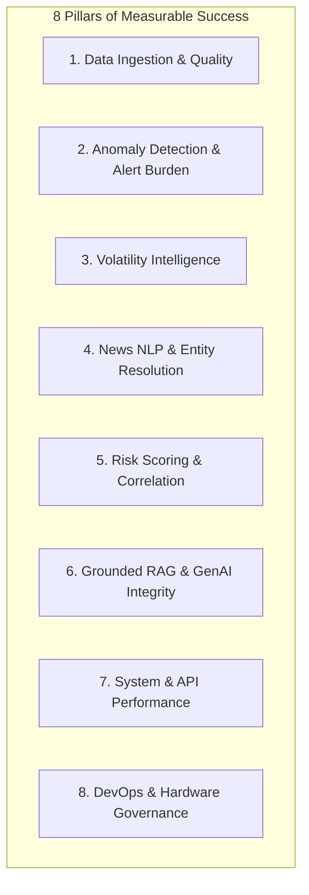
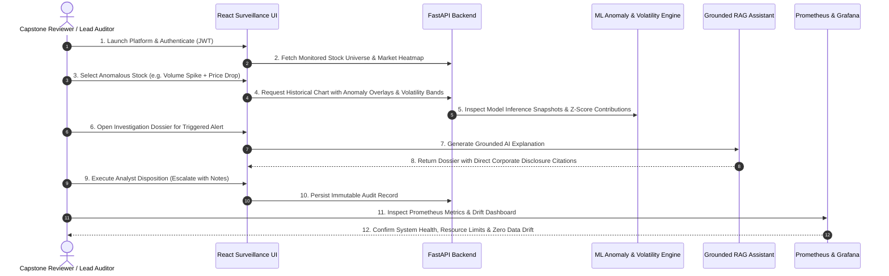

# MEASURABLE SUCCESS CRITERIA & VERIFICATION MATRIX
# MARKET SENTINEL AI
## AI-Powered Stock Market Surveillance and Risk Intelligence Platform

---

## Document Control
- **Document Version**: 1.0.0
- **Status**: APPROVED / BASELINE
- **Author**: Principal System Architect & Lead Product Owner
- **Single Source of Truth**: [`docs/MASTER_IMPLEMENTATION_PROMPT.md`](file:///e:/Praxis/TERM%203/MARKET%20SENTINEL%20AI/docs/MASTER_IMPLEMENTATION_PROMPT.md)
- **Operational Guidelines**: [`AGENTS.md`](file:///e:/Praxis/TERM%203/MARKET%20SENTINEL%20AI/AGENTS.md)

---

## 1. Evaluation Philosophy & Principles

To prevent vanity metrics, subjective assessments, or unverified claims, all success criteria for **Market Sentinel AI** adhere to four foundational principles:

1. **Empirical Measurability**: Every target metric must be quantitatively verifiable via automated unit tests, integration test suites, backtesting replay scripts, or observability logs.
2. **Authentic Financial Grounding**: Model evaluation must strictly use authentic market records and corporate disclosures. No synthetic prices or simulated return distributions shall be used to assert model performance.
3. **Temporal Integrity (Zero Look-Ahead Bias)**: All ML, NLP, and risk scoring metrics must be measured on strictly out-of-sample, chronological test splits (walk-forward validation).
4. **Hardware-Aware Accountability**: Performance targets are benchmarked against the actual resource constraints of the host environment: **Windows 11, 16 GB RAM, x86_64 CPU, zero dedicated GPU**.

---

## 2. Pillar-Wise Measurable Success Criteria

### Pillar 1: Data Ingestion & Data Quality
| Metric ID | Performance Metric | Baseline / Legacy | Target Threshold | Verification Method |
|---|---|---|---|---|
| **SC-1.1** | **Ingestion Integrity** | Manual download / fragmented scripts | **100%** schema compliance; zero unhandled schema drift exceptions | Automated Pydantic/GreatExpectations ingestion validation suite |
| **SC-1.2** | **Duplicate & Null Handling** | Silent drops / unindexed duplicates | **0%** duplicate (symbol, timestamp) records; **0%** unhandled nulls | Database unique constraints & automated data quality tests |
| **SC-1.3** | **Data Traceability & Lineage** | Untracked source origin | **100%** of records store source provider, fetch timestamp, and file hash | Database audit column verification |
| **SC-1.4** | **Zero Synthetic Data Mandate** | Fabricated test data | **100%** authentic market records in training & evaluation pipelines | Data source registry audit |

---

### Pillar 2: Abnormal Trading Activity Detection & False Positive Burden
| Metric ID | Performance Metric | Baseline / Legacy | Target Threshold | Verification Method |
|---|---|---|---|---|
| **SC-2.1** | **False Positive Triage Burden** | $> 90\%$ false positive alerts with static $3\sigma$ threshold rules | **$\ge 50\%$ reduction** in routine high-beta noise alerts | Historical replay benchmark comparing static rules vs. Isolation Forest |
| **SC-2.2** | **Extreme Movement Capture** | Missed anomalies due to rigid fixed thresholds | **$\ge 95\%$ recall** on benchmark historical extreme price/volume shock events | Labeled historical event test set (e.g. major index outlier dates) |
| **SC-2.3** | **Anomaly Score Calibration** | Arbitrary boolean triggers | Normalized continuous score $[0.0, 1.0]$ with monotonic percentile rank | Statistical calibration test on validation return distributions |
| **SC-2.4** | **Temporal Validation Rigor** | Random train/test split | **100%** chronological walk-forward splits; zero future feature leakage | Automated feature leakage audit test script |

---

### Pillar 3: Volatility Intelligence & Forecasting
| Metric ID | Performance Metric | Baseline / Legacy | Target Threshold | Verification Method |
|---|---|---|---|---|
| **SC-3.1** | **Forecast Error (RMSE / MAE)** | Naive 20-day rolling standard deviation | GARCH(1,1) / EWMA achieves **$\ge 10\%$ lower RMSE** than naive rolling mean | Out-of-sample walk-forward forecast evaluation across 50 liquid stocks |
| **SC-3.2** | **Volatility Clustering Capture** | Static risk assumption | GARCH $\alpha + \beta < 1.0$ stationarity check verified on $> 90\%$ of modeled stocks | Econometric parameter convergence validation test |
| **SC-3.3** | **Forecast Latency** | Slow grid-search fitting | **$< 250\text{ ms}$** per stock for 5-day horizon forecast inference | Benchmark latency profiling test |

---

### Pillar 4: News NLP, Entity Recognition & Event Classification
| Metric ID | Performance Metric | Baseline / Legacy | Target Threshold | Verification Method |
|---|---|---|---|---|
| **SC-4.1** | **Company-to-Ticker Mapping Precision** | Manual search across filing portals | **$\ge 85\%$ Precision** on standardized company test set | Labeled test set of 200 corporate announcement headlines |
| **SC-4.2** | **Event Classification Macro-F1** | Unclassified text feeds | **$\ge 0.75$ Macro-F1** across core event categories (Earnings, M&A, Regulatory, etc.) | Multi-class confusion matrix validation on labeled event set |
| **SC-4.3** | **Syndicate Deduplication Ratio** | Duplicate news flooding alert feed | **$\ge 90\%$ detection** of syndicated / reprinted identical stories | Cosine similarity & hash deduplication benchmark |

---

### Pillar 5: Market-News Correlation & Risk Alert Engine
| Metric ID | Performance Metric | Baseline / Legacy | Target Threshold | Verification Method |
|---|---|---|---|---|
| **SC-5.1** | **Alert Prioritization Efficacy** | Uniform alert queue with no severity ranking | Calibrated tiering: **Critical ($\le 5\%$)**, **High ($\le 15\%$)**, **Medium/Low ($\ge 80\%$)** | Historical backtest alert distribution analysis |
| **SC-5.2** | **Lead/Lag Correlation Window** | No temporal linkage | Ingests disclosures across $[-48\text{h}, +24\text{h}]$ window with verified event alignment | Temporal cross-join verification unit test |
| **SC-5.3** | **Alert Auditability** | Unexplained alert triggers | **100%** of alerts link to input feature snapshots, model versions, and source URLs | Database schema foreign key & non-null verification |

---

### Pillar 6: Generative AI, RAG & Zero-Hallucination Integrity
| Metric ID | Performance Metric | Baseline / Legacy | Target Threshold | Verification Method |
|---|---|---|---|---|
| **SC-6.1** | **Citation Coverage** | LLM unverified prose generation | **100%** of factual claims in generated dossiers cite retrieved source document IDs | Automated regex & citation extraction audit on generated dossiers |
| **SC-6.2** | **Zero-Hallucination Defense** | LLM hallucinates explanations for unbacked moves | **100%** compliance with fallback message: *"Insufficient evidence found"* when no filings exist | Test harness with empty/unrelated document retrieval injections |
| **SC-6.3** | **Semantic Retrieval Recall@5** | Keyword search missing synonyms | **$\ge 80\%$ Recall@5** for relevant disclosures using `pgvector` hybrid search | Labeled question-document retrieval benchmark |
| **SC-6.4** | **Token Budget & Cost Control** | Unbounded LLM calls | **100%** of LLM requests enforce max token limits ($\le 1024$ tokens) and Redis response caching | API proxy logging & Redis cache hit verification |

---

### Pillar 7: Analyst Workflow & System Performance
| Metric ID | Performance Metric | Baseline / Legacy | Target Threshold | Verification Method |
|---|---|---|---|---|
| **SC-7.1** | **Analyst Triage Duration** | $45-60\text{ minutes}$ manual investigation per alert | **$< 5\text{ minutes}$** using pre-compiled AI investigation dossiers | User experience workflow timing drill |
| **SC-7.2** | **REST API Latency** | Sluggish synchronous queries | **$p95 < 200\text{ ms}$** for market data and alert list endpoints | Locust / Pytest-benchmark API stress suite |
| **SC-7.3** | **End-to-End Dossier Generation** | Multi-minute manual synthesis | **$< 5.0\text{ seconds}$** total (Retrieval + Groq LLM inference) | Automated performance test |
| **SC-7.4** | **Real-Time Notification Lag** | Polling delays (minutes) | **$< 1.0\text{ second}$** SSE push latency from alert creation to browser UI | SSE client timestamp delta test |

---

### Pillar 8: Infrastructure, DevOps & Hardware Resource Governance
| Metric ID | Performance Metric | Baseline / Legacy | Target Threshold | Verification Method |
|---|---|---|---|---|
| **SC-8.1** | **Host RAM Containment** | Out-of-memory container crashes | **$\le 6.0\text{ GB}$ aggregate Docker RAM** for active profiles on 16 GB host | Docker stats logging during active operational runs |
| **SC-8.2** | **Profile Isolation** | All services booted concurrently | **100%** service profile separation (`core`, `data`, `streaming`, `monitoring`) | Docker Compose configuration test |
| **SC-8.3** | **Automated Test Coverage** | Untested codebases | **$\ge 80\%$ statement coverage** across backend services and ML pipelines | Pytest coverage report (`pytest --cov`) |
| **SC-8.4** | **CI Build Reliability** | Manual local builds | **100% green builds** on GitHub Actions for linting, tests, and Docker builds | GitHub Actions CI execution badge |

---

## 3. Verification & Acceptance Testing Protocol

To satisfy Section 16 of [`docs/MASTER_IMPLEMENTATION_PROMPT.md`](file:///e:/Praxis/TERM%203/MARKET%20SENTINEL%20AI/docs/MASTER_IMPLEMENTATION_PROMPT.md), the final product acceptance rehearsal must successfully execute the following end-to-end verification protocol:

---

## 4. Phase 1 Sign-Off & Governance Gate

With the completion of this document, all six foundational steps of **Phase 1: Business Definition and System Design** have been authored, validated, and aligned:
- **Step 1.1**: Final Business Problem Statement ([`docs/business/business_problem_statement.md`](file:///e:/Praxis/TERM%203/MARKET%20SENTINEL%20AI/docs/business/business_problem_statement.md))
- **Step 1.2**: Business Requirements Document ([`docs/business/BRD.md`](file:///e:/Praxis/TERM%203/MARKET%20SENTINEL%20AI/docs/business/BRD.md))
- **Step 1.3**: Product Scope & Boundary Definition ([`docs/business/product_scope.md`](file:///e:/Praxis/TERM%203/MARKET%20SENTINEL%20AI/docs/business/product_scope.md))
- **Step 1.4**: Functional & System Architecture ([`docs/architecture/system_architecture.md`](file:///e:/Praxis/TERM%203/MARKET%20SENTINEL%20AI/docs/architecture/system_architecture.md))
- **Step 1.5**: Technology Decision Records ([`docs/architecture/technology_decision_records.md`](file:///e:/Praxis/TERM%203/MARKET%20SENTINEL%20AI/docs/architecture/technology_decision_records.md))
- **Step 1.6**: Measurable Success Criteria & Verification Matrix ([`docs/business/success_criteria.md`](file:///e:/Praxis/TERM%203/MARKET%20SENTINEL%20AI/docs/business/success_criteria.md))
