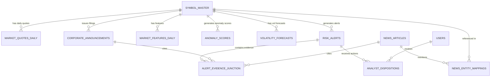

# MASTER DATA DICTIONARY & SCHEMA TYPINGS
# MARKET SENTINEL AI
## AI-Powered Stock Market Surveillance and Risk Intelligence Platform

---

## Document Control
- **Document Version**: 1.0.0
- **Status**: APPROVED / BASELINE
- **Author**: Principal System Architect & Lead Product Owner
- **Single Source of Truth**: [`docs/MASTER_IMPLEMENTATION_PROMPT.md`](file:///e:/Praxis/TERM%203/MARKET%20SENTINEL%20AI/docs/MASTER_IMPLEMENTATION_PROMPT.md)
- **Operational Guidelines**: [`AGENTS.md`](file:///e:/Praxis/TERM%203/MARKET%20SENTINEL%20AI/AGENTS.md)

---

## 1. Architectural Conventions & Global Standards

Every entity and attribute in **Market Sentinel AI** conforms to the following standardized data standards:

1. **Numeric Precision Standard**:
   - Monetary values (prices, turnover) are stored as `NUMERIC(12, 2)` or `NUMERIC(18, 2)` to eliminate floating-point arithmetic imprecision.
   - Normalized metrics, returns, and ratios are stored as `NUMERIC(10, 6)`.
   - Volumes and share quantities are stored as `BIGINT`.
2. **Timezone & Temporal Standard**:
   - All database timestamps are timezone-aware UTC (`TIMESTAMPTZ` in PostgreSQL, ISO 8601 strings in Parquet/JSON: `YYYY-MM-DDTHH:MM:SSZ`).
   - News and corporate filings explicitly track two timestamps:
     - `published_at_utc`: Time the external announcement was made public.
     - `ingested_at_utc`: Time Market Sentinel AI processed and stored the record.
3. **Surveillance & Audit Traceability**:
   - Every entity carries audit columns: `created_at_utc`, `updated_at_utc`, `source_provider_id`, and `data_hash`.
4. **Primary Keys & Identifiers**:
   - Transactional and analytical tables use UUIDv4 (`UUID`) primary keys to ensure conflict-free replication and distributed ingestion.

---

## 2. Entity-Relationship Data Model

---

## 3. Comprehensive Entity Dictionary

### 3.1 Entity: `symbol_master`
- **Description**: Canonical company reference master defining tickers, legal names, sectoral taxonomies, and NLP alias indices.
- **Physical Table / File**: PostgreSQL `symbol_master` | `data/master/symbol_master.parquet`

| Column Name | SQL Type | Nullable | Constraints | Description & Valid Ranges |
|---|---|---|---|---|
| `symbol` | `VARCHAR(20)` | No | **PK** | Exchange ticker identifier (e.g. `RELIANCE`, `TCS`). |
| `company_name` | `VARCHAR(255)` | No | None | Official registered legal corporate entity name. |
| `isin` | `VARCHAR(12)` | No | **UNIQUE** | 12-character ISIN code (e.g. `INE002A01018`). |
| `sector` | `VARCHAR(100)` | No | None | Macro industry sector classification (e.g. `Energy`). |
| `industry` | `VARCHAR(150)` | No | None | Granular segment (e.g. `Oil & Gas Refining & Marketing`). |
| `exchange` | `VARCHAR(10)` | No | None | Primary listing exchange (`NSE`). |
| `series` | `VARCHAR(5)` | No | Default `'EQ'` | Trading series. Strictly `'EQ'` for common equities. |
| `listing_date` | `DATE` | No | None | Exchange listing date (`YYYY-MM-DD`). |
| `market_cap_tier`| `VARCHAR(20)` | No | Check In | Cap tier: `'LARGE_CAP'`, `'MID_CAP'`, `'SMALL_CAP'`. |
| `is_active` | `BOOLEAN` | No | Default `TRUE` | Surveillance status flag. |
| `aliases` | `JSONB` | No | None | Array of colloquial names, abbreviations, executive names. |
| `created_at_utc` | `TIMESTAMPTZ` | No | Default `NOW()` | Timestamp record was registered. |

---

### 3.2 Entity: `market_quotes_daily`
- **Description**: Authentic historical and daily end-of-day OHLCV and delivery records.
- **Physical Table / File**: PostgreSQL `market_quotes_daily` | `data/raw/market/`

| Column Name | SQL Type | Nullable | Constraints | Description & Valid Ranges |
|---|---|---|---|---|
| `id` | `UUID` | No | **PK** | Unique record identifier (UUIDv4). |
| `symbol` | `VARCHAR(20)` | No | **FK** $\rightarrow$ `symbol_master` | Monitored stock symbol. |
| `trade_date` | `DATE` | No | None | Trading session date (`YYYY-MM-DD`). |
| `open_price` | `NUMERIC(12, 2)` | No | $> 0$ | Opening price in INR. |
| `high_price` | `NUMERIC(12, 2)` | No | $\ge \text{low}$ | Intraday high traded price in INR. |
| `low_price` | `NUMERIC(12, 2)` | No | $> 0$ | Intraday low traded price in INR. |
| `close_price` | `NUMERIC(12, 2)` | No | $> 0$ | Official session closing/settlement price in INR. |
| `volume` | `BIGINT` | No | $\ge 0$ | Total number of shares executed in session. |
| `turnover` | `NUMERIC(18, 2)` | No | $\ge 0$ | Total gross monetary turnover in INR. |
| `delivery_qty` | `BIGINT` | Yes | $\ge 0$ | Total deliverable share quantity. |
| `delivery_pct` | `NUMERIC(6, 2)` | Yes | Range $[0, 100]$ | Percentage of traded volume resulting in delivery. |
| `source_provider`| `VARCHAR(50)` | No | None | Origin identifier (e.g. `'SRC-NSE-EOD'`). |
| `ingested_at_utc`| `TIMESTAMPTZ` | No | Default `NOW()` | Timestamp when record was ingested. |
| **Constraint** | **UNIQUE** | No | `(symbol, trade_date)` | Enforces exactly one daily market record per symbol. |

---

### 3.3 Entity: `corporate_announcements`
- **Description**: Official corporate filings and regulatory disclosures submitted to exchanges.
- **Physical Table / File**: PostgreSQL `corporate_announcements` | `data/raw/announcements/`

| Column Name | SQL Type | Nullable | Constraints | Description & Valid Ranges |
|---|---|---|---|---|
| `id` | `UUID` | No | **PK** | Unique announcement identifier (UUIDv4). |
| `symbol` | `VARCHAR(20)` | No | **FK** $\rightarrow$ `symbol_master` | Associated stock symbol. |
| `category` | `VARCHAR(100)` | No | None | Category (e.g. `'EARNINGS'`, `'BOARD_MEETING'`, `'M&A'`). |
| `subject` | `VARCHAR(500)` | No | None | Official announcement headline or filing subject. |
| `body_text` | `TEXT` | Yes | None | Full text or synopsis extracted from the filing. |
| `attachment_url`| `VARCHAR(1000)`| Yes | None | Canonical link to PDF disclosure document. |
| `published_at_utc`| `TIMESTAMPTZ` | No | None | Exact exchange release timestamp. |
| `ingested_at_utc` | `TIMESTAMPTZ` | No | Default `NOW()` | System ingestion timestamp. |
| `source_provider` | `VARCHAR(50)` | No | None | Origin identifier (`'SRC-NSE-CORP-ANNOUNCEMENTS'`). |

---

### 3.4 Entity: `news_articles`
- **Description**: Public financial news articles ingested from verified RSS feeds and public APIs.
- **Physical Table / File**: PostgreSQL `news_articles` | `data/raw/news/`

| Column Name | SQL Type | Nullable | Constraints | Description & Valid Ranges |
|---|---|---|---|---|
| `id` | `UUID` | No | **PK** | Unique article identifier (UUIDv4). |
| `canonical_url` | `VARCHAR(1000)`| No | **UNIQUE** | Canonical article URL (used for deduplication). |
| `title` | `VARCHAR(500)` | No | None | Cleaned news headline. |
| `summary` | `TEXT` | Yes | None | Article excerpt or synopsis. |
| `body_text` | `TEXT` | Yes | None | Full normalized text content. |
| `source_outlet` | `VARCHAR(100)` | No | None | Publishing news agency (e.g. `'Economic Times'`). |
| `published_at_utc`| `TIMESTAMPTZ` | No | None | Original publication timestamp. |
| `ingested_at_utc` | `TIMESTAMPTZ` | No | Default `NOW()` | Ingestion timestamp. |
| `sentiment_score` | `NUMERIC(4, 3)` | Yes | Range $[-1.0, 1.0]$ | Polarity score ($+1.0$ = Bullish, $-1.0$ = Bearish). |

---

### 3.5 Entity: `market_features_daily`
- **Description**: Clean, chronological financial features computed strictly on past data (zero look-ahead bias).
- **Physical Table / File**: PostgreSQL `market_features_daily` | `data/features/market_features.parquet`

| Column Name | SQL Type | Nullable | Constraints | Description & Formula |
|---|---|---|---|---|
| `id` | `UUID` | No | **PK** | Feature record identifier. |
| `symbol` | `VARCHAR(20)` | No | **FK** $\rightarrow$ `symbol_master` | Stock symbol. |
| `feature_date` | `DATE` | No | None | Feature computation date ($T$). |
| `return_daily` | `NUMERIC(10, 6)` | No | None | Simple return: $(P_T - P_{T-1}) / P_{T-1}$. |
| `return_log` | `NUMERIC(10, 6)` | No | None | Continuously compounded return: $\ln(P_T / P_{T-1})$. |
| `return_roll_20d` | `NUMERIC(10, 6)` | No | None | 20-day rolling mean return. |
| `volatility_roll_20d`| `NUMERIC(10, 6)`| No | $\ge 0$ | 20-day rolling annualized standard deviation of log returns. |
| `volume_ratio_20d`| `NUMERIC(10, 4)` | No | $\ge 0$ | Volume relative to 20-day moving average: $V_T / \bar{V}_{20d}$. |
| `volume_zscore_20d`| `NUMERIC(8, 4)` | No | None | Standardized volume score: $(V_T - \bar{V}_{20d}) / \sigma_{V, 20d}$. |
| `price_gap` | `NUMERIC(10, 6)` | No | None | Overnight price gap: $(\text{Open}_T - \text{Close}_{T-1}) / \text{Close}_{T-1}$. |
| `delivery_zscore_20d`| `NUMERIC(8, 4)`| Yes | None | 20-day standardized delivery percentage deviation. |
| **Constraint** | **UNIQUE** | No | `(symbol, feature_date)` | One feature snapshot per symbol per date. |

---

### 3.6 Entity: `anomaly_scores`
- **Description**: Statistical and machine learning anomaly detection outputs evaluated at timestamp $T$.
- **Physical Table / File**: PostgreSQL `anomaly_scores` | `data/models/anomaly_scores.parquet`

| Column Name | SQL Type | Nullable | Constraints | Description & Interpretation |
|---|---|---|---|---|
| `id` | `UUID` | No | **PK** | Anomaly record identifier. |
| `symbol` | `VARCHAR(20)` | No | **FK** $\rightarrow$ `symbol_master` | Stock symbol. |
| `score_date` | `DATE` | No | None | Date anomaly was evaluated. |
| `baseline_zscore` | `NUMERIC(8, 4)` | No | None | Combined price and volume statistical Z-score. |
| `isoforest_score` | `NUMERIC(8, 6)` | No | Range $[0.0, 1.0]$ | Isolation Forest anomaly score ($1.0$ = extreme outlier). |
| `is_anomaly` | `BOOLEAN` | No | None | Boolean flag: `True` if anomaly score exceeds threshold. |
| `feature_snapshot`| `JSONB` | No | None | Immutable snapshot of input features at evaluation time. |
| `model_version` | `VARCHAR(50)` | No | None | MLflow model version identifier (e.g. `'isoforest_v1.2.0'`). |
| `created_at_utc` | `TIMESTAMPTZ` | No | Default `NOW()` | Timestamp score was computed. |

---

### 3.7 Entity: `volatility_forecasts`
- **Description**: Econometric volatility estimates and short-term volatility cluster forecasts.
- **Physical Table / File**: PostgreSQL `volatility_forecasts`

| Column Name | SQL Type | Nullable | Constraints | Description & Units |
|---|---|---|---|---|
| `id` | `UUID` | No | **PK** | Forecast record identifier. |
| `symbol` | `VARCHAR(20)` | No | **FK** $\rightarrow$ `symbol_master` | Stock symbol. |
| `forecast_date` | `DATE` | No | None | Effective date of forecast. |
| `model_type` | `VARCHAR(50)` | No | Check In | Model: `'EWMA'`, `'GARCH_1_1'`, `'HISTORICAL_ROLLING'`. |
| `horizon_days` | `INT` | No | Default `5` | Forecast window (e.g. 5 trading days ahead). |
| `forecast_volatility`| `NUMERIC(10, 6)`| No | $> 0$ | Annualized conditional volatility forecast ($\sigma_{\text{cond}}$). |
| `ci_lower_95` | `NUMERIC(10, 6)`| Yes | $\ge 0$ | 95% Confidence Interval lower bound. |
| `ci_upper_95` | `NUMERIC(10, 6)`| Yes | $\ge \text{ci\_lower}$ | 95% Confidence Interval upper bound. |
| `model_version` | `VARCHAR(50)` | No | None | Tracking version (e.g. `'garch_arch_v1.0'`). |

---

### 3.8 Entity: `risk_alerts`
- **Description**: Prioritized investigation alerts synthesized from market anomalies, volatility, and news context.
- **Physical Table / File**: PostgreSQL `risk_alerts`

| Column Name | SQL Type | Nullable | Constraints | Description & Values |
|---|---|---|---|---|
| `id` | `UUID` | No | **PK** | Unique alert identifier. |
| `symbol` | `VARCHAR(20)` | No | **FK** $\rightarrow$ `symbol_master` | Flagged stock ticker. |
| `alert_date` | `DATE` | No | None | Alert trigger date. |
| `risk_score` | `NUMERIC(5, 2)` | No | Range $[0.0, 100.0]$ | Composite multi-factor risk score. |
| `priority_tier` | `VARCHAR(20)` | No | Check In | Priority: `'CRITICAL'`, `'HIGH'`, `'MEDIUM'`, `'LOW'`. |
| `alert_category`| `VARCHAR(50)` | No | None | Type: `'UNUSUAL_VOLUME'`, `'PRICE_DISLOCATION'`, `'UNBACKED_SURGE'`. |
| `anomaly_score_id`| `UUID` | Yes | **FK** $\rightarrow$ `anomaly_scores` | Contributing anomaly record link. |
| `has_matching_news`| `BOOLEAN` | No | None | `True` if filings/news were detected in $[-48\text{h}, +24\text{h}]$. |
| `dossier_status` | `VARCHAR(30)` | No | Default `'PENDING'` | Status: `'PENDING'`, `'GENERATED'`, `'FAILED'`. |
| `review_status` | `VARCHAR(30)` | No | Default `'UNREVIEWED'` | Review: `'UNREVIEWED'`, `'ESCALATED'`, `'DISMISSED'`. |
| `created_at_utc`| `TIMESTAMPTZ` | No | Default `NOW()` | Timestamp alert was generated. |

---

### 3.9 Entity: `analyst_dispositions`
- **Description**: Immutable audit log of analyst reviews, escalations, dismissals, and formal case notes.
- **Physical Table / File**: PostgreSQL `analyst_dispositions`

| Column Name | SQL Type | Nullable | Constraints | Description & Business Rules |
|---|---|---|---|---|
| `id` | `UUID` | No | **PK** | Disposition log identifier. |
| `alert_id` | `UUID` | No | **FK** $\rightarrow$ `risk_alerts` | Associated alert identifier. |
| `user_id` | `UUID` | No | None | Reviewing analyst identifier. |
| `action` | `VARCHAR(50)` | No | Check In | Action: `'ESCALATE_TO_SAR'`, `'DISMISS_LEGITIMATE'`, `'REQUEST_INFO'`. |
| `disposition_notes`| `TEXT` | No | Min length 10 | Mandatory analyst justification comments. |
| `reviewed_at_utc` | `TIMESTAMPTZ` | No | Default `NOW()` | Exact timestamp of disposition. |

---

## 4. Storage Engine & Partitioning Strategy

1. **PostgreSQL Relational Partitioning**:
   - `market_quotes_daily` and `market_features_daily` will utilize **Range Partitioning by Year** (`trade_date` / `feature_date`) to ensure high-performance query execution and fast historical backfill scans.
2. **Columnar Parquet Feature Storage**:
   - Analytical feature matrices are partitioned on local disk by symbol and year:
     `data/features/market_features.parquet/year=YYYY/symbol=SYMBOL/data.parquet`
   - Preserves snappy compression and enables sub-millisecond column-slice queries for ML model training.
3. **Vector Co-Location**:
   - Document chunk embeddings (`1536` or `384` dimensions) are attached directly to document chunks in a dedicated table `document_chunks` utilizing `pgvector` indexing (`HNSW` with Cosine distance).
