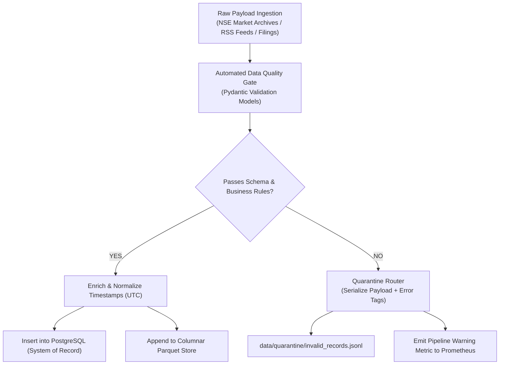

# DATA QUALITY & INTEGRITY VALIDATION FRAMEWORK
# MARKET SENTINEL AI
## AI-Powered Stock Market Surveillance and Risk Intelligence Platform

---

## Document Control
- **Document Version**: 1.0.0
- **Status**: APPROVED / BASELINE
- **Author**: Principal System Architect & Lead Product Owner
- **Single Source of Truth**: [`docs/MASTER_IMPLEMENTATION_PROMPT.md`](file:///e:/Praxis/TERM%203/MARKET%20SENTINEL%20AI/docs/MASTER_IMPLEMENTATION_PROMPT.md)
- **Operational Guidelines**: [`AGENTS.md`](file:///e:/Praxis/TERM%203/MARKET%20SENTINEL%20AI/AGENTS.md)

---

## 1. Quality Governance & Core Principles

In financial market surveillance, bad data corrupts anomaly detection models, generates false alarms, and compromises regulatory investigations. The **Data Quality & Integrity Validation Framework** serves as the automated gatekeeper across all ingestion streams.

It is founded upon four non-negotiable governance principles:
1. **Zero Synthetic Financial Data Mandate**: In accordance with Section 7.1 of the Master Prompt, all evaluated market records must originate from genuine, traceable financial feeds. Never generate fake stock prices or invent market history for model training.
2. **Never Silently Discard**: Malformed, incomplete, or corrupted records must **never** be silently dropped or ignored. All rejected payloads must be logged with diagnostic metadata and routed to the quarantine storage buffer (`data/quarantine/`).
3. **Point-in-Time Temporal Consistency**: Ingested records must be strictly validated against look-ahead bias and timestamp inconsistencies ($t_{\text{published}} \le t_{\text{ingested}}$).
4. **Pre-Persistence Validation**: All raw payloads must pass strict Pydantic model validation **before** executing database upserts or writing to Parquet feature stores.

---

## 2. Ingestion Quality Gate Architecture



---

## 3. Pillar-Wise Data Quality Rules & Error Codes

### 3.1 Market Data Quality Rules (`market_quotes_daily`)
| Rule ID | Rule Name | Business Assertion / Formula | Severity | Action on Breach |
|---|---|---|---|---|
| **DQ-MKT-01** | **Price Positivity** | `open > 0`, `low > 0`, `close > 0` | CRITICAL | Quarantine record (Error: `ERR_INVALID_PRICE_NONPOSITIVE`) |
| **DQ-MKT-02** | **High/Low Consistency**| `high >= low` | CRITICAL | Quarantine record (Error: `ERR_INVERTED_HIGH_LOW`) |
| **DQ-MKT-03** | **High Boundary** | `high >= open` AND `high >= close` | CRITICAL | Quarantine record (Error: `ERR_HIGH_BELOW_OPEN_CLOSE`) |
| **DQ-MKT-04** | **Low Boundary** | `low <= open` AND `low <= close` | CRITICAL | Quarantine record (Error: `ERR_LOW_ABOVE_OPEN_CLOSE`) |
| **DQ-MKT-05** | **Volume Non-Negativity**| `volume >= 0` | CRITICAL | Quarantine record (Error: `ERR_NEGATIVE_VOLUME`) |
| **DQ-MKT-06** | **Delivery Boundary** | `delivery_qty <= volume` | HIGH | Quarantine record (Error: `ERR_DELIVERY_EXCEEDS_VOLUME`) |
| **DQ-MKT-07** | **Delivery Pct Bound** | `0.0 <= delivery_pct <= 100.0` | HIGH | Quarantine record (Error: `ERR_DELIVERY_PCT_OUT_OF_BOUNDS`) |
| **DQ-MKT-08** | **Active Symbol Check** | `symbol IN symbol_master.symbol` | MEDIUM | Quarantine record (Error: `ERR_UNREGISTERED_SYMBOL`) |
| **DQ-MKT-09** | **Turnover Consistency**| $\text{Turnover} \approx \text{Volume} \times \text{VWAP}$ ($\pm 30\%$) | WARNING | Log warning; flag for manual inspection |

### 3.2 News & Corporate Announcement Quality Rules
| Rule ID | Rule Name | Business Assertion / Formula | Severity | Action on Breach |
|---|---|---|---|---|
| **DQ-NEWS-01**| **Headline Integrity** | `length(title) >= 10` AND `title != NULL` | HIGH | Quarantine record (Error: `ERR_EMPTY_HEADLINE`) |
| **DQ-NEWS-02**| **Canonical URL Valid**| Valid HTTP/HTTPS format | HIGH | Quarantine record (Error: `ERR_INVALID_CANONICAL_URL`) |
| **DQ-NEWS-03**| **Temporal Skew** | `published_at <= current_time + 5m` | HIGH | Quarantine future-dated articles (Error: `ERR_FUTURE_PUBLICATION_DATE`) |
| **DQ-NEWS-04**| **Duplicate URL** | `canonical_url` unique in database | MEDIUM | Deduplicate; update existing record metadata |
| **DQ-NEWS-05**| **Text Quality** | HTML tags stripped; `body_text` $> 50$ chars | MEDIUM | Sanitize text; quarantine if body is empty |

---

## 4. Pydantic Runtime Validation Schemas

Below are the canonical Pydantic models enforcing pre-persistence quality gates in Python:

```python
from datetime import date, datetime, timezone
from decimal import Decimal
from typing import Optional
from pydantic import BaseModel, Field, model_validator

class MarketQuoteIngestSchema(BaseModel):
    """Pydantic validation model for raw daily market quotes."""
    symbol: str = Field(..., min_length=1, max_length=20)
    trade_date: date
    open_price: Decimal = Field(..., gt=Decimal("0.0"))
    high_price: Decimal = Field(..., gt=Decimal("0.0"))
    low_price: Decimal = Field(..., gt=Decimal("0.0"))
    close_price: Decimal = Field(..., gt=Decimal("0.0"))
    volume: int = Field(..., ge=0)
    turnover: Decimal = Field(..., ge=Decimal("0.0"))
    delivery_qty: Optional[int] = Field(None, ge=0)
    delivery_pct: Optional[Decimal] = Field(None, ge=Decimal("0.0"), le=Decimal("100.0"))
    source_provider: str = Field(..., min_length=2, max_length=50)

    @model_validator(mode="after")
    def validate_price_boundaries(self) -> "MarketQuoteIngestSchema":
        if self.high_price < self.low_price:
            raise ValueError(f"High price ({self.high_price}) cannot be lower than Low price ({self.low_price})")
        if self.high_price < self.open_price or self.high_price < self.close_price:
            raise ValueError(f"High price ({self.high_price}) must be >= Open ({self.open_price}) and Close ({self.close_price})")
        if self.low_price > self.open_price or self.low_price > self.close_price:
            raise ValueError(f"Low price ({self.low_price}) must be <= Open ({self.open_price}) and Close ({self.close_price})")
        if self.delivery_qty is not None and self.delivery_qty > self.volume:
            raise ValueError(f"Delivery quantity ({self.delivery_qty}) cannot exceed total volume ({self.volume})")
        return self


class NewsArticleIngestSchema(BaseModel):
    """Pydantic validation model for raw financial news articles."""
    canonical_url: str = Field(..., min_length=10, max_length=1000)
    title: str = Field(..., min_length=10, max_length=500)
    summary: Optional[str] = None
    body_text: Optional[str] = None
    source_outlet: str = Field(..., min_length=2, max_length=100)
    published_at_utc: datetime

    @model_validator(mode="after")
    def validate_temporal_sanity(self) -> "NewsArticleIngestSchema":
        now_utc = datetime.now(timezone.utc)
        # Allow up to 5 minutes of server clock skew
        if self.published_at_utc.tzinfo is None:
            raise ValueError("published_at_utc must be timezone-aware (UTC)")
        if (self.published_at_utc - now_utc).total_seconds() > 300:
            raise ValueError(f"Publication timestamp ({self.published_at_utc}) is skewed in the future relative to server time ({now_utc})")
        return self
```

---

## 5. Quarantine & Dead-Letter Queue Protocol

When a record breaches a critical validation rule during ingestion:

1. **Quarantine Packaging**: The raw unparsed payload, incoming source headers, failed validation error message, error code, and failure timestamp are packaged into a structured JSON envelope:
   ```json
   {
     "quarantine_id": "7f9b8c3e-89a1-4d3e-b876-1e92d8f34a1b",
     "error_code": "ERR_INVERTED_HIGH_LOW",
     "error_message": "High price (2400.00) cannot be lower than Low price (2450.00)",
     "source_provider": "SRC-NSE-EOD",
     "raw_payload": {
       "symbol": "RELIANCE",
       "trade_date": "2026-11-17",
       "open": 2420.0,
       "high": 2400.0,
       "low": 2450.0,
       "close": 2410.0,
       "volume": 5000000
     },
     "quarantined_at_utc": "2026-11-17T09:28:15Z"
   }
   ```
2. **Persistence**: Appended atomically to `data/quarantine/invalid_records.jsonl`.
3. **Observability**: Increments the Prometheus counter `marketsentinel_ingestion_quarantine_total{source="SRC-NSE-EOD", error="ERR_INVERTED_HIGH_LOW"}`.
4. **Resilience**: The ingestion pipeline continues processing remaining clean records in the batch without halting the worker process.
