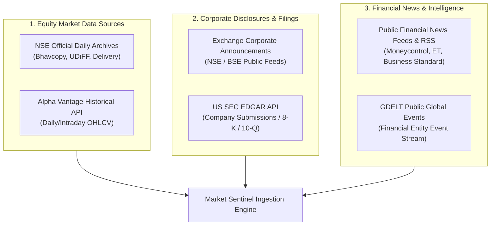

# DATA SOURCE REGISTER & ACQUISITION STRATEGY
# MARKET SENTINEL AI
## AI-Powered Stock Market Surveillance and Risk Intelligence Platform

---

## Document Control
- **Document Version**: 1.0.0
- **Status**: APPROVED / BASELINE
- **Author**: Principal System Architect & Lead Product Owner
- **Single Source of Truth**: [`docs/MASTER_IMPLEMENTATION_PROMPT.md`](file:///e:/Praxis/TERM%203/MARKET%20SENTINEL%20AI/docs/MASTER_IMPLEMENTATION_PROMPT.md)
- **Operational Guidelines**: [`AGENTS.md`](file:///e:/Praxis/TERM%203/MARKET%20SENTINEL%20AI/AGENTS.md)

---

## 1. Data Governance & Regulatory Policy

Market Sentinel AI enforces strict data ethics and governance in compliance with Section 7 of [`docs/MASTER_IMPLEMENTATION_PROMPT.md`](file:///e:/Praxis/TERM%203/MARKET%20SENTINEL%20AI/docs/MASTER_IMPLEMENTATION_PROMPT.md) and Section 1 of [`AGENTS.md`](file:///e:/Praxis/TERM%203/MARKET%20SENTINEL%20AI/AGENTS.md):

1. **Zero Synthetic Financial Data Mandate**:
   - Market prices, volumes, returns, and delivery metrics evaluated in model training, testing, and production surveillance MUST originate exclusively from genuine, traceable financial sources.
   - Fabricating synthetic stock prices or simulated market histories is strictly prohibited.
2. **Legal & Licensing Compliance**:
   - Access to external data providers complies fully with official Terms of Service, licensing agreements, `robots.txt` guidelines, and designated API rate limits.
   - No paywalls shall be bypassed, no authentication gates subverted, and no unauthorized login-gated portals scraped.
3. **Auditability & Traceability**:
   - Every ingested market quote, news headline, and corporate disclosure must persist immutable metadata: source provider ID, fetch timestamp, source URL/file reference, and content hash.
4. **Historical vs. Live Operational Distinction**:
   - In accordance with Section 7.2 of the Master Prompt, the core surveillance MVP is **batch-first** using authentic historical exchange archives. Real-time streaming is reserved for legitimate public news/disclosure feeds; no fake live NSE ticker streams shall be fabricated.

---

## 2. Comprehensive Data Source Register

---

### Source Category 1: Indian Equity Market Data

#### 1.1 National Stock Exchange of India (NSE) — Official Daily Reports & Archives
- **Source Identifier**: `SRC-NSE-EOD`
- **Data Provider**: National Stock Exchange of India Ltd.
- **Access URL / Endpoint**:
  - All Reports Portal: `https://www.nseindia.com/all-reports/`
  - Daily Bhavcopy (UDiFF): Official end-of-day reports (e.g. `BhavCopy_NSE_CM_0_0_0_<YYYYMMDD>_F_0000.csv.zip`)
  - Delivery Position Reports: Daily security-wise delivery position reports (`MTO_<DDMMYYYY>.DAT`)
  - Bulk & Block Deals: Daily published bulk deal summaries (`bulk_<DDMMYYYY>.csv`)
- **Historical Availability**: 10+ years of daily archives; updated each trading day post-market close ($\approx 18:30\text{ IST}$).
- **Key Ingested Fields**:
  - `TradDt` / `Date`: Trading date.
  - `TckrSymb` / `Symbol`: Exchange equity ticker (e.g. `RELIANCE`, `TCS`, `INFY`).
  - `OpnPric` / `Open`: Opening price.
  - `HghPric` / `High`: Day's highest traded price.
  - `LwPric` / `Low`: Day's lowest traded price.
  - `ClsPric` / `Close`: Official closing price.
  - `TtlTradgVol` / `Volume`: Total number of shares executed.
  - `TtlTrfVal` / `Turnover`: Total traded turnover in INR.
  - `DlvryQty`: Total deliverable quantity (from MTO report).
  - `DlvryPer`: Deliverable quantity to traded quantity percentage.
- **Authentication**: Publicly accessible official reports. HTTP requests require standard headers (User-Agent, Referer) without violating session quotas.
- **Update Frequency**: Daily (End of Day).
- **Licensing & Terms**: Publicly released official market summaries for analytical and research evaluation.
- **Operational Strategy**: Primary ground truth for Indian market anomaly detection, baseline calculation, and backtesting.

---

### Source Category 2: International Market Data & Cross-Validation

#### 1.2 Alpha Vantage Equity Time-Series API
- **Source Identifier**: `SRC-ALPHAVANTAGE`
- **Data Provider**: Alpha Vantage Inc.
- **Documentation**: `https://www.alphavantage.co/documentation/`
- **Endpoints Utilized**:
  - `TIME_SERIES_DAILY_ADJUSTED`: Daily adjusted OHLCV with split and dividend adjustments.
  - `TIME_SERIES_INTRADAY`: 5-min, 15-min, 60-min intervals for granular intraday anomaly backtesting.
- **Historical Availability**: Up to 20 years of daily historical data.
- **Key Ingested Fields**:
  - `timestamp`: Date/Time of bar.
  - `open`, `high`, `low`, `close`, `adjusted_close`: Price metrics.
  - `volume`: Traded volume.
  - `dividend_amount`, `split_coefficient`: Corporate adjustments.
- **Authentication**: API Key via query parameter (`apikey=...`). Stored in `.env` (`ALPHA_VANTAGE_API_KEY`).
- **Rate Limits & Free-Tier Quotas**: 25 requests per day on free tier.
- **Operational Strategy**: Used as a secondary cross-validation feed and for benchmark international index/ticker comparisons (e.g. US ADRs of Indian equities like `INFY`, `WIT`). Ingestion scripts will implement aggressive local Parquet caching to prevent quota exhaustion.

---

### Source Category 3: Corporate Disclosures & Regulatory Filings

#### 1.3 Official Exchange Corporate Announcements (NSE / BSE Announcements)
- **Source Identifier**: `SRC-NSE-CORP-ANNOUNCEMENTS`
- **Data Provider**: National Stock Exchange of India & Bombay Stock Exchange.
- **Access Portal**: Official public corporate disclosure portals (`https://www.nseindia.com/companies-listing/corporate-filings-announcements`).
- **Historical Availability**: Rolling historical disclosures for all listed entities.
- **Key Ingested Fields**:
  - `symbol`: Listed company ticker.
  - `company_name`: Official legal entity name.
  - `broadcast_date_time`: Exact exchange release timestamp.
  - `subject` / `category`: Headline classification (e.g. Board Meeting, Financial Results, Acquisition, Credit Rating, Resignation).
  - `announcement_text`: Clean text body or summary.
  - `attachment_url`: PDF link to formal signed disclosure.
- **Authentication**: Public web disclosures; requires session cookie initialization via standard client headers.
- **Operational Strategy**: High-priority ground truth for Phase 8 correlation and Phase 9 RAG dossiers.

#### 1.4 US SEC EDGAR Public Submissions API
- **Source Identifier**: `SRC-SEC-EDGAR`
- **Data Provider**: U.S. Securities and Exchange Commission.
- **Documentation**: `https://www.sec.gov/search-filings/edgar-application-programming-interfaces`
- **Endpoints Utilized**:
  - Submissions API: `https://data.sec.gov/submissions/CIK{cik.zfill(10)}.json`
  - Company Facts API: `https://data.sec.gov/api/xbrl/companyfacts/CIK{cik.zfill(10)}.json`
- **Key Ingested Fields**:
  - `form`: Filing type (`8-K` Material Events, `10-Q` Quarterly Report, `10-K` Annual Report).
  - `filingDate`: Date filing was accepted.
  - `acceptanceDateTime`: Exact second-level acceptance timestamp.
  - `items`: Categorization of material event (e.g. Item 1.01 Entry into Material Definitive Agreement, Item 5.02 Departure of Directors).
- **Authentication**: No API key; requires a declared `User-Agent: Sample Company Name AdminContact@<sample company domain>.com` header.
- **Rate Limit**: Maximum 10 requests per second.
- **Operational Strategy**: Provides structured, second-level regulatory disclosure timestamps for validating cross-listed equities and establishing benchmark disclosure-to-price correlation models.

---

### Source Category 4: Financial News & Event Intelligence

#### 1.5 Legitimate Financial News Feeds & Public RSS Streams
- **Source Identifier**: `SRC-FIN-NEWS-RSS`
- **Providers**: Major verified financial media outlets (e.g. Moneycontrol, Economic Times, Business Standard, Reuters RSS).
- **Access Method**: Standard public XML/RSS 2.0 and Atom feeds.
- **Historical Availability**: Live streaming updates with 7–30 day rolling feed history.
- **Key Ingested Fields**:
  - `title`: Article headline.
  - `link`: Canonical URL.
  - `published_at`: Standardized RFC 822 / ISO 8601 publication timestamp.
  - `description` / `summary`: Initial news synopsis.
  - `source_outlet`: Publishing news organization.
- **Authentication**: None required for public RSS feeds.
- **Operational Strategy**: Powers the real-time event streaming demonstrator in Redpanda (Phase 4) and provides unstructured text for NLP Named Entity Recognition (Phase 7).

#### 1.6 GDELT Project (Global Database of Events, Language, and Tone)
- **Source Identifier**: `SRC-GDELT`
- **Data Provider**: The GDELT Project (`https://www.gdeltproject.org/`).
- **Access Endpoint**: GDELT 2.0 Doc API (`https://api.gdeltproject.org/api/v2/doc/doc`).
- **Key Ingested Fields**:
  - `url`, `title`, `seendate`: Article metadata and discovery timestamp.
  - `socialimage`, `domain`, `language`: Metadata.
  - `tone`: Aggregate emotional and sentiment polarity score.
- **Authentication**: None required.
- **Operational Strategy**: Supplementary global news event validation for macro-level market shocks.

---

## 3. Data Source Evaluation & Trade-off Matrix

| Source ID | Coverage Domain | Frequency | Ingestion Latency | Rate Limits | License Cost | Reliability Tier |
|---|---|---|---|---|---|---|
| `SRC-NSE-EOD` | Indian Equities (OHLCV + Delivery) | Daily (EOD) | Post-market ($\sim 18:30\text{ IST}$) | Public batches | Zero (Free) | **Tier 1 (Authoritative)** |
| `SRC-ALPHAVANTAGE` | US & Cross-listed Equities | Daily / Intraday | Near real-time / EOD | 25 req/day (Free) | Zero (Free-tier) | **Tier 2 (Secondary / Cached)** |
| `SRC-NSE-CORP-ANNOUNCEMENTS` | Indian Corporate Disclosures | Intraday / Continuous | 5–15 min batch | Public web headers | Zero (Free) | **Tier 1 (Authoritative)** |
| `SRC-SEC-EDGAR` | US Disclosures (8-K, 10-Q) | Continuous | Second-level | $\le 10\text{ req/sec}$ | Zero (Public Domain) | **Tier 1 (Authoritative)** |
| `SRC-FIN-NEWS-RSS` | Financial Media News Feeds | Continuous / 15-min | Real-time broadcast | Standard RSS poll | Zero (Public RSS) | **Tier 2 (Media Stream)** |
| `SRC-GDELT` | Global Financial News & Sentiment | 15-min batches | 15–30 min | Public queries | Zero (Open Data) | **Tier 3 (Supplementary)** |

---

## 4. Ingestion Risk Mitigation & Resilience Protocols

1. **Provider Outage & Rate-Limit Shielding**:
   - Every external client must implement **exponential backoff with jitter** (`tenacity` library in Python) handling HTTP 429, 502, 503, and 504 errors.
   - All downloaded raw responses must be immediately written to local disk cache (`data/raw/` in compressed Parquet/JSON lines) before downstream database insertion. Once ingested, local pipelines query the persistent cache.
2. **Entity Ambiguity & Resolution**:
   - News articles frequently refer to companies by colloquial names (e.g. "Reliance", "Mukesh Ambani's firm") rather than exchange tickers (`RELIANCE`). Step 2.3 will construct a dedicated Company & Symbol Master with extensive alias indices and confidence thresholds.
3. **Data Quality Gate**:
   - Raw records must pass Pydantic schema validation prior to relational insertion. Any record with negative prices, impossible timestamps ($t_{\text{published}} > t_{\text{ingested}}$), or zero volume during normal trading hours will be routed to a dead-letter quarantine table (`data_quality_quarantine`) with error diagnostics.
