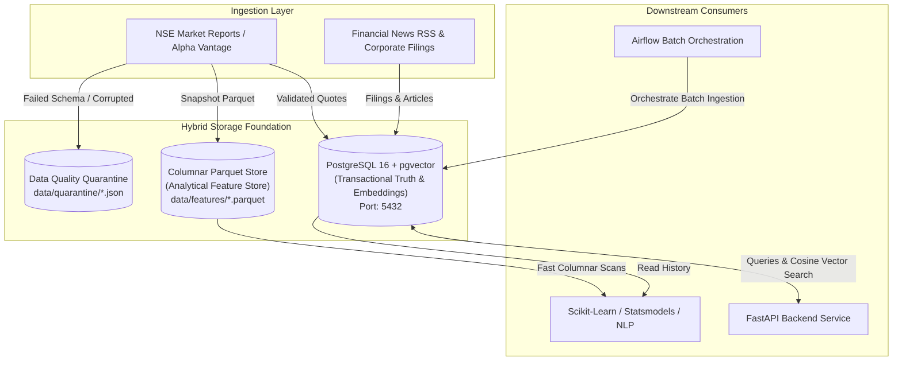

# STORAGE ARCHITECTURE & DATABASE DESIGN
# MARKET SENTINEL AI
## AI-Powered Stock Market Surveillance and Risk Intelligence Platform

---

## Document Control
- **Document Version**: 1.0.0
- **Status**: APPROVED / BASELINE
- **Author**: Principal System Architect & Lead Product Owner
- **Single Source of Truth**: [`docs/MASTER_IMPLEMENTATION_PROMPT.md`](file:///e:/Praxis/TERM%203/MARKET%20SENTINEL%20AI/docs/MASTER_IMPLEMENTATION_PROMPT.md)
- **Operational Guidelines**: [`AGENTS.md`](file:///e:/Praxis/TERM%203/MARKET%20SENTINEL%20AI/AGENTS.md)

---

## 1. Hybrid Storage Strategy

**Market Sentinel AI** implements a hybrid storage architecture balancing ACID transactional guarantees with high-throughput columnar analytics and co-located vector search:



1. **Transactional System of Record (PostgreSQL 16+)**:
   - Stores master entities, raw market quotes, corporate announcements, processed news, risk alerts, and regulatory analyst audit trails.
   - Enforces ACID integrity, foreign keys, uniqueness constraints, and non-null validation.
2. **Vector Similarity Store (`pgvector` Extension)**:
   - Co-located inside PostgreSQL in the `document_chunks` table.
   - Utilizes `vector(384)` embeddings indexed via **HNSW** (Hierarchical Navigable Small World) with cosine distance (`vector_cosine_ops`), supporting sub-$50\text{ ms}$ hybrid semantic retrieval.
3. **Analytical Columnar Feature Store (Parquet)**:
   - Stores time-series feature snapshots on local disk (`data/features/`) compressed using Snappy.
   - Enables fast, memory-mapped vector operations in Pandas/Polars during model training without saturating database connection pools.
4. **Data Quality Quarantine**:
   - Isolates corrupted records, inverted prices, or unparseable payloads in `data/quarantine/` for operational auditing.

---

## 2. Directory Layout & Physical Manifest

The local repository filesystem layout is organized as follows:

```
data/
├── master/                          # Master company & symbol references
│   ├── symbol_master.json           # JSON reference master
│   ├── symbol_master.csv            # Tabular reference
│   └── symbol_master.parquet        # Columnar Snappy reference
├── raw/                             # Raw ingested payloads (cached)
│   ├── market/                      # EOD Bhavcopy & delivery archives
│   ├── news/                        # Ingested financial news JSON lines
│   └── announcements/               # Corporate filings text & metadata
├── features/                        # Chronological feature snapshots
│   └── market_features.parquet      # 20d rolling returns, volatility, Z-scores
├── models/                          # Serialized ML artifacts & scores
│   ├── anomaly_scores.parquet       # Historical anomaly inferences
│   └── volatility_forecasts.parquet # GARCH/EWMA conditional estimates
└── quarantine/                      # Data quality dead-letter records
    └── invalid_records.jsonl        # Quarantined raw payloads with error tags
```

---

## 3. Database Connection & Pool Configuration

To operate stably within the **16 GB RAM host environment** (Docker memory limit: $2.0\text{ GB}$ for PostgreSQL), the connection pool and database tuning parameters are configured as follows:

| Parameter | Configuration Value | Architectural Rationale |
|---|---|---|
| **PostgreSQL Port** | `5432` | Standard PostgreSQL service port. |
| **Max Connections** | `100` | Prevents connection memory spikes on the 16 GB host. |
| **FastAPI Pool Size** | `10` connections | Dedicated async connection pool for API queries. |
| **FastAPI Max Overflow**| `20` connections | Temporary burst allowance for high concurrent alert triage. |
| **Airflow Pool Size** | `5` connections | Bounded pool for batch ingestion tasks. |
| **Shared Buffers** | `512 MB` | Optimized for 2.0 GB container RAM footprint. |
| **Work Mem** | `16 MB` | Prevents out-of-memory errors during complex sort/join operations. |
| **Vector Index Type** | `HNSW` (`m=16`, `ef_construction=64`)| Fast graph-based vector search with low memory indexing footprint. |

---

## 4. DDL Migration Verification

The initial DDL migration script [`scripts/sql/01_initial_schema.sql`](file:///e:/Praxis/TERM%203/MARKET%20SENTINEL%20AI/scripts/sql/01_initial_schema.sql) defines:
- **Extensions**: `uuid-ossp` and `vector`.
- **10 Tables**: `symbol_master`, `market_quotes_daily`, `corporate_announcements`, `news_articles`, `document_chunks`, `market_features_daily`, `anomaly_scores`, `volatility_forecasts`, `risk_alerts`, and `analyst_dispositions`.
- **Integrity Checks**: High/low price validation (`high >= low`, `high >= open`, `high >= close`), non-negative prices and volumes, and foreign key cascading.
- **Performance Indexes**: B-Tree composite indexes on `(symbol, trade_date DESC)` and HNSW cosine vector index on `document_chunks.embedding`.
