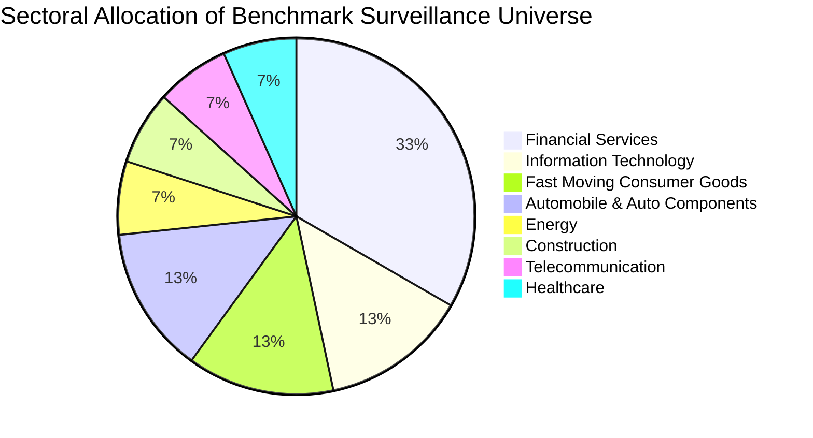
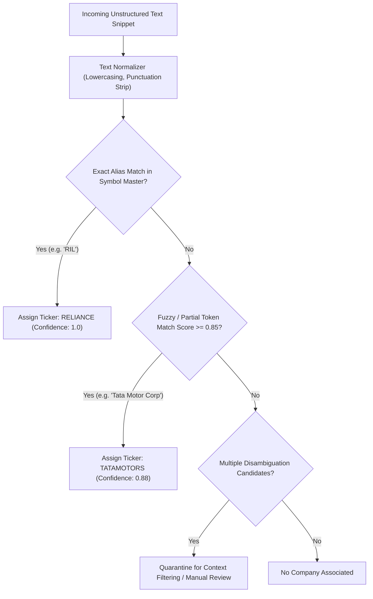

# COMPANY & SYMBOL MASTER SPECIFICATION
# MARKET SENTINEL AI
## AI-Powered Stock Market Surveillance and Risk Intelligence Platform

---

## Document Control
- **Document Version**: 1.0.0
- **Status**: APPROVED / BASELINE
- **Author**: Principal System Architect & Lead Product Owner
- **Single Source of Truth**: [`docs/MASTER_IMPLEMENTATION_PROMPT.md`](file:///e:/Praxis/TERM%203/MARKET%20SENTINEL%20AI/docs/MASTER_IMPLEMENTATION_PROMPT.md)
- **Operational Guidelines**: [`AGENTS.md`](file:///e:/Praxis/TERM%203/MARKET%20SENTINEL%20AI/AGENTS.md)

---

## 1. Executive Overview & Purpose

In financial surveillance, raw market records are indexed by exchange equity tickers (e.g. `RELIANCE`, `TCS`, `INFY`), whereas corporate disclosures and financial media articles refer to companies by formal legal names, colloquial abbreviations, or executive leadership names (e.g. *"Reliance Industries Limited"*, *"RIL"*, *"Mukesh Ambani's conglomerate"*).

The **Company & Symbol Master** serves as the authoritative, central entity reference for **Market Sentinel AI**. It standardizes:
1. Canonical exchange tickers, legal names, and unique International Securities Identification Numbers (ISINs).
2. Sectoral and industrial taxonomy.
3. Exchange listing series (strictly filtering regular equity `EQ`).
4. A rich **Entity Alias Index** empowering Phase 7 Named Entity Recognition (NER) and entity disambiguation.

---

## 2. Schema Specification & Field Dictionary

| Field Name | Storage Type | Nullable | Primary / Unique | Description & Business Rules |
|---|---|---|---|---|
| `symbol` | `VARCHAR(20)` | No | **PK** | Official primary exchange trading symbol (e.g. `RELIANCE`). |
| `company_name` | `VARCHAR(255)` | No | Yes | Full registered legal corporate entity name. |
| `isin` | `VARCHAR(12)` | No | **Unique** | 12-character International Securities Identification Number. |
| `sector` | `VARCHAR(100)` | No | No | High-level industry sector (e.g. `Information Technology`, `Energy`). |
| `industry` | `VARCHAR(150)` | No | No | Granular industrial segment (e.g. `IT Services & Consulting`). |
| `exchange` | `VARCHAR(10)` | No | No | Primary listing exchange (`NSE`). |
| `series` | `VARCHAR(5)` | No | No | Instrument series (strictly `EQ` for common equities). |
| `listing_date` | `DATE` | No | No | Date company was initially listed on the exchange (`YYYY-MM-DD`). |
| `market_cap_tier`| `VARCHAR(20)` | No | No | Market capitalization classification (`LARGE_CAP`, `MID_CAP`). |
| `is_active` | `BOOLEAN` | No | No | Active surveillance status flag (`True` = actively monitored). |
| `aliases` | `JSON / TEXT[]`| No | No | Array of colloquial names, abbreviations, and executive entity links. |

---

## 3. Initial Benchmark Equities Universe

The initial benchmark surveillance universe consists of 15 large-cap constituents representing major sectors:

| Symbol | Company Name | ISIN | Sector | Primary Aliases |
|---|---|---|---|---|
| `RELIANCE` | Reliance Industries Limited | `INE002A01018` | Energy | `Reliance`, `RIL`, `Reliance Industries`, `Mukesh Ambani firm` |
| `TCS` | Tata Consultancy Services Limited | `INE467B01029` | Information Technology | `TCS`, `Tata Consultancy`, `Tata Consultancy Services` |
| `HDFCBANK` | HDFC Bank Limited | `INE040A01034` | Financial Services | `HDFC Bank`, `HDFC`, `Housing Development Finance Corp` |
| `INFY` | Infosys Limited | `INE009A01021` | Information Technology | `Infosys`, `Infosys Tech`, `Infy`, `Narayana Murthy firm` |
| `ICICIBANK` | ICICI Bank Limited | `INE090A01021` | Financial Services | `ICICI Bank`, `ICICI` |
| `HINDUNILVR`| Hindustan Unilever Limited | `INE030A01027` | FMCG | `Hindustan Unilever`, `HUL`, `Unilever India` |
| `ITC` | ITC Limited | `INE154A01025` | FMCG | `ITC`, `Imperial Tobacco Company`, `ITC Ltd` |
| `SBIN` | State Bank of India | `INE062A01020` | Financial Services | `SBI`, `State Bank of India`, `State Bank` |
| `BHARTIARTL`| Bharti Airtel Limited | `INE397D01024` | Telecommunication | `Airtel`, `Bharti Airtel`, `Sunil Mittal firm` |
| `KOTAKBANK` | Kotak Mahindra Bank Limited | `INE237A01028` | Financial Services | `Kotak Bank`, `Kotak Mahindra Bank`, `Kotak Mahindra` |
| `LT` | Larsen & Toubro Limited | `INE018A01030` | Construction | `Larsen & Toubro`, `L&T`, `Larsen and Toubro` |
| `AXISBANK` | Axis Bank Limited | `INE238A01034` | Financial Services | `Axis Bank`, `UTI Bank` |
| `TATAMOTORS`| Tata Motors Limited | `INE155A01022` | Automobile | `Tata Motors`, `TaMo`, `Tata Commercial Vehicles`, `JLR parent` |
| `SUNPHARMA` | Sun Pharmaceutical Industries Ltd | `INE044A01036` | Healthcare | `Sun Pharma`, `Sun Pharmaceutical`, `Sun Pharma Industries` |
| `MARUTI` | Maruti Suzuki India Limited | `INE585B01010` | Automobile | `Maruti`, `Maruti Suzuki`, `Maruti Udyog` |

---

## 4. Entity Disambiguation & Alias Mapping Logic

### Disambiguation Heuristics:
1. **Case-Insensitive Exact Matching**: Compares raw normalized noun phrases against the `aliases` array. A direct hit yields a confidence score of $1.0$.
2. **Contextual Disambiguation**: When an alias like *"Tata"* appears in isolation, the resolver scans surrounding context for sectoral tokens (*"vehicles"*, *"software"*, *"steel"*) to correctly route to `TATAMOTORS`, `TCS`, or `TATASTEEL`.
3. **Audit Trail**: Every entity mapping recorded in the database stores:
   - `detected_entity_text`: Raw string extracted by NLP.
   - `resolved_symbol`: Mapped exchange ticker.
   - `confidence_score`: Value between $0.0$ and $1.0$.
   - `matching_algorithm`: `EXACT_ALIAS`, `FUZZY_TOKEN`, or `CONTEXTUAL_DISAMBIGUATION`.

---

## 5. Artifact Manifest & Physical Storage

The Company & Symbol Master has been compiled and persisted in three interoperable formats within the repository:
1. `data/master/symbol_master.json`: Human-readable JSON reference format.
2. `data/master/symbol_master.csv`: Standard tabular CSV format for lightweight inspections.
3. `data/master/symbol_master.parquet`: Columnar, Snappy-compressed binary format for high-speed feature join operations.
